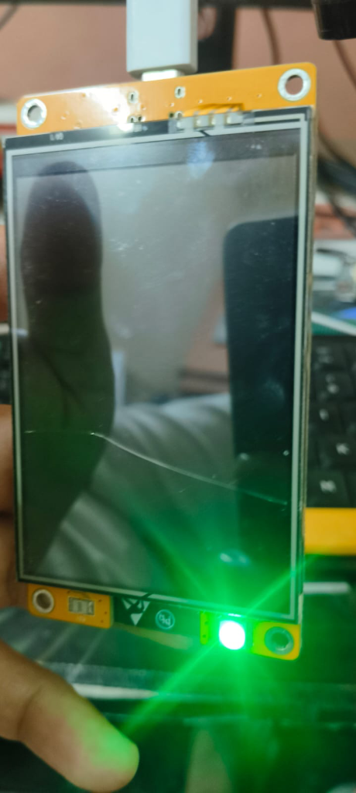
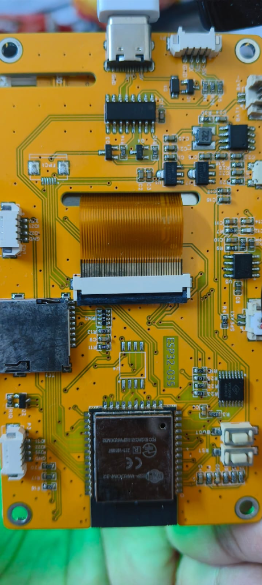
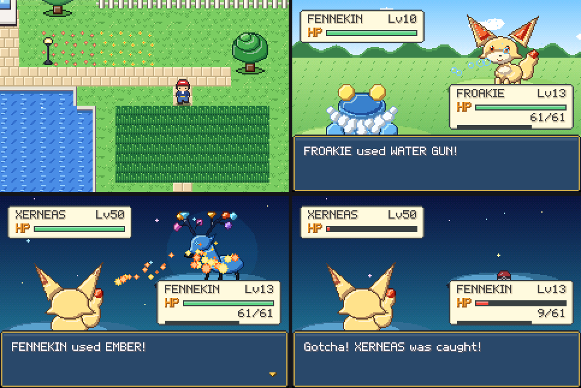
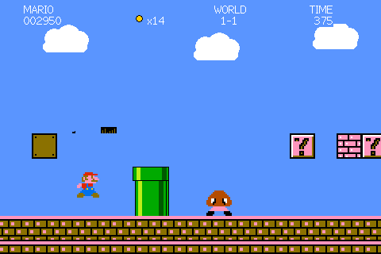
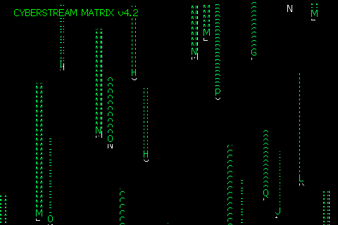
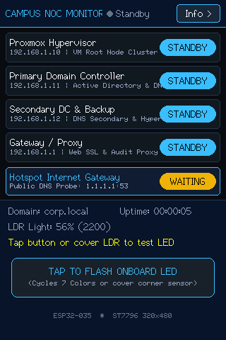
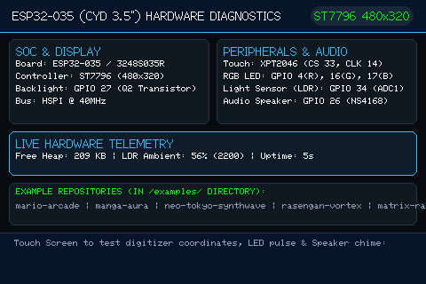
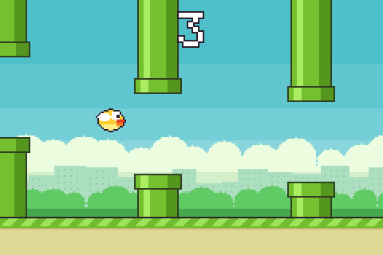

# 📺 ESP32-035 (CYD 3.5" / ESP32-3248S035R) Working Guide & Dashboard

[](https://platformio.org/)
[]()
[]()
[]()

## 🧒 Start here (for students)

This board is a tiny computer (an **ESP32** chip) built onto the back of a 3.5-inch colour touch
screen. It also has a small light that can glow in different colours (an **RGB LED**), a speaker, and
a **light sensor** that notices when you cover it with your fingertip. You write a program on a
computer, send it to the board through a USB cable, and then the board runs it all by itself.
Each folder in [`examples/`](examples/) is one finished project you can put on the board.

**You need:** this board, a USB-C cable that can carry data (some cables only charge), and a computer
with **VS Code** and the **PlatformIO** extension (free apps for writing code and sending it to the
board; your teacher can install them once).

**To run a project:**
1. Download this project (green **Code** button on GitHub, then **Download ZIP**, then unzip it) and
   open the folder in VS Code. The first time, PlatformIO needs a few minutes to download its tools.
2. Pick a project from the table and pictures further down. **Matrix Rain** and **Neo-Tokyo
   Synthwave** are good first picks because they need no extra setup.
3. Plug the board into the computer with the USB cable.
4. In the PlatformIO sidebar (the ant-head icon), open **Project Tasks**, then the project's env
   name (for example `env:matrix_rain`), then click **Upload**.
5. Wait for `SUCCESS`. The board restarts and your project appears on the screen.

**Stuck?** If the upload says it can't find the port (the name of the USB connection), the
`upload_port` and `monitor_port` lines in `platformio.ini` name the owner's computer: ask your
teacher to change them to your computer's port (like `COM3` on Windows) or delete them. Windows may
also need the free **CH340** USB driver. Some of these boards have a cracked touch screen, so several
projects also let you **cover the light sensor** instead of tapping.

## 🔧 Board details (for the curious)

> **⚠️ WARNING FOR MAKERS & AI CODING ASSISTANTS:**  
> Even though this board is often marketed as a "Cheap Yellow Display" (CYD), **it is NOT the same as the classic 2.8" CYD (`ESP32-2432S028R`)**.  
> If you upload standard 2.8" CYD code to this board, **the screen will stay completely black** because the backlight is wired to **GPIO 27** (instead of GPIO 21) and the touch controller shares the **HSPI bus** rather than using a separate SPI port.

---

## 📸 Hardware Identification

Look at the silkscreen marking on the back of your PCB:
- Right between the ribbon cable connector and the ESP32-WROOM module, you will see a silkscreen box that reads: **`ESP32-035`**.
- This board is sold on AliExpress/Alibaba under names such as **TZT ESP32 3.5 Inch LCD**, **Sunton ESP32-3248S035R**, or **MSP3520**.

| Front Display (480x320) | Back PCB (`ESP32-035` Silkscreen) |
| :---: | :---: |
|  |  |

---

## ⚡ Key Differences: 2.8" CYD vs. 3.5" ESP32-035

| Specification / Pin | Classic 2.8" CYD (`ESP32-2432S028R`) | 3.5" Board (**`ESP32-035` / `3248S035R`**) |
| :--- | :--- | :--- |
| **Screen Resolution** | 320 × 240 (QVGA) | **480 × 320 (HVGA)** |
| **Display Controller** | ILI9341 / ST7789 | **ST7796** *(or ILI9488 on some panel batches)* |
| **Backlight Pin (BL)** | `GPIO 21` | **`GPIO 27` (Drives transistor Q2)** |
| **Touch Controller** | XPT2046 on separate VSPI (`25, 32, 39, 33`) | **XPT2046 on shared HSPI (`14, 12, 13, CS: 33, IRQ: 36`)** |
| **RGB LED** | Pins 4 (R), 16 (G), 17 (B) — Active LOW | **Pins 4 (R), 16 (G), 17 (B) — Active LOW** *(Identical)* |
| **Light Sensor (LDR)**| Analog ADC1 (`GPIO 34`) | **Analog ADC1 (`GPIO 34`)** *(Identical)* |
| **USB Interface** | Micro-USB (or dual Type-C on Rev 2) | **USB Type-C** (connected to CH340C serial chip) |

---

## 🛠️ Complete Pinout Reference Table

| Peripheral | Signal / Function | ESP32 GPIO Pin | Description |
| :--- | :--- | :---: | :--- |
| **TFT Display** | Backlight Control | **`GPIO 27`** | Active HIGH. Drives backlight driver transistor Q2 |
| | MOSI / SDI | **`GPIO 13`** | Hardware HSPI Data Out |
| | MISO / SDO | **`GPIO 12`** | Hardware HSPI Data In |
| | SCLK / SCK | **`GPIO 14`** | Hardware HSPI Clock |
| | Chip Select (CS)| **`GPIO 15`** | Dedicated LCD Chip Select (Active LOW) |
| | DC / RS | **`GPIO 2`** | Data / Command register select |
| | Reset (RST) | **`-1` / `EN`** | Connected to board system reset |
| **Touch (XPT2046)**| Chip Select (CS)| **`GPIO 33`** | Dedicated Touch Chip Select |
| | Interrupt (IRQ) | **`GPIO 36`** | Touch detect interrupt (`SENSOR_VP`) |
| | MOSI / MISO / CLK| **`13, 12, 14`** | Shares hardware HSPI bus with the display |
| **Onboard RGB LED**| Red Channel | **`GPIO 4`** | Active LOW (0 = ON, 1 = OFF) |
| | Green Channel | **`GPIO 16`** | Active LOW (0 = ON, 1 = OFF) |
| | Blue Channel | **`GPIO 17`** | Active LOW (0 = ON, 1 = OFF) |
| **Sensors & Audio**| LDR Light Sensor | **`GPIO 34`** | Ambient light CdS photoresistor (ADC1) |
| | Speaker | **`GPIO 26`** | Audio amplifier (NS4168 / FM8002A) |
| **MicroSD Slot** | TF SPI Bus | **`CS: 5, MOSI: 23, SCLK: 18, MISO: 19`** | Dedicated separate VSPI bus |

---

## 📁 Repository Structure & Standalone Examples

The root of this repository is dedicated solely to the **Physical Board Hardware Reference & Diagnostics Suite**. Every project and visual animation is isolated in its own self-contained sub-repository under `examples/` with dedicated source code, headers, and docs:

```
├── README.md                      # Physical board specifications & pinout guide
├── platformio.ini                 # Multi-environment PlatformIO build configuration
├── docs/                          # Physical board photos and diagrams
├── src/main.cpp                   # Hardware Verification & Pinout Diagnostics Suite
├── tools/cyd-emu/                 # Desktop emulator: screenshots of any example without hardware
└── examples/
    ├── mario-arcade/              # Standalone Mario platformer tribute (plays itself, 3-button takeover)
    ├── pokemon-kalos/             # Standalone POKéMON Kalos tribute (display + tap-to-play)
    ├── video-clip/                # Standalone video clip player (JPEG frames + DAC audio from flash)
    ├── cloud-game/                # Thin client: plays a game streamed from a server over Wi-Fi (Flappy tribute)
    ├── screen-mirror/             # Live copy of a computer's screen: website + USB cable, or Wi-Fi from a Mac
    ├── manga-aura/                # Standalone Manga Ultra Instinct aura
    ├── neo-tokyo-synthwave/       # Standalone 3D Synthwave wireframe grid
    ├── rasengan-vortex/           # Standalone 3D Rasengan particle vortex
    ├── matrix-rain/               # Standalone Digital Katakana matrix rain
    └── noc-dashboard/             # Standalone Enterprise NOC telemetry dashboard
```

| Project / Environment | PlatformIO Env | Description | Direct Link |
| :--- | :---: | :--- | :---: |
| **Hardware Diagnostics** | `[env:cyd]` | Pinout verification, touch test, LDR light sensor, RGB LED cycle, and audio chime. | [`src/main.cpp`](src/main.cpp) |
| **Super Mario Bros Arcade** | `[env:mario_arcade]` | Mario platformer tribute: 32 levels (8 worlds), power-ups, Goombas / Koopas / Piranhas, flagpole. Plays itself; press JUMP / FIRE / RUN on the right edge to take over. | [`examples/mario-arcade/`](examples/mario-arcade/) |
| **POKéMON Kalos Tribute** | `[env:pokemon_kalos]` | GBA-style Route walk + battles with Kalos starters and Xerneas / Yveltal / Zygarde. Plays itself; tap to play (1 tap / 2 taps). | [`examples/pokemon-kalos/`](examples/pokemon-kalos/) |
| **Video Clip Player** | `[env:video_clip]` | Plays a looping video clip with sound: JPEG frames zoomed 2x (240x136, 15 fps) or 3x (160x90, for ~2.5 min clips), 8-bit audio through the DAC on GPIO 26. Convert your own video with `tools/make_clip.py`, or stream a whole video over Wi-Fi from a server. 1 tap = pause, 2 taps = mute, cover the light sensor = skip 4 s. | [`examples/video-clip/`](examples/video-clip/) |
| **Cloud Game (Flappy tribute)** | `[env:cloud_game]` | The game runs on a Sipeed NanoKVM and streams 240x160 frames over Wi-Fi at 25-30 fps; this board draws them and sends back one button (cover the light sensor). | [`examples/cloud-game/`](examples/cloud-game/) |
| **Screen Mirror** | `[env:screen_mirror]` | Shows a computer's screen, window or tab on the board. Easiest: the [Screen Mirror website](https://novice130.github.io/ESP32-035-CYD-3.5-display/) installs it and shares over a USB cable from Chrome/Edge. Or Wi-Fi from a Mac with `tools/mirror.sh`. Sends only what changed, full 480x320 when calm, half resolution while a lot moves; ~28 fps with full-screen video. Idea by Abdul Samad Idowu. | [`examples/screen-mirror/`](examples/screen-mirror/) |
| **Manga Ultra Instinct** | `[env:manga_aura]` | Glowing anime eyes, dynamic radial action speedlines, menacing JoJo SFX (ゴゴゴ), and electric lightning arcs. | [`examples/manga-aura/`](examples/manga-aura/) |
| **Neo-Tokyo 2088 Synthwave** | `[env:neo_tokyo_synthwave]` | 3D perspective infinite neon wireframe grid, retro anime sun with scanline cuts, and Mt. Fuji silhouette. | [`examples/neo-tokyo-synthwave/`](examples/neo-tokyo-synthwave/) |
| **Rasengan Ki Energy Vortex** | `[env:rasengan_vortex]` | 90+ particles swirling in a 3D spherical vortex, concentric opposing rings, and pulsing energy shockwaves. | [`examples/rasengan-vortex/`](examples/rasengan-vortex/) |
| **Digital Katakana Matrix Rain** | `[env:matrix_rain]` | 28 cascading vertical columns of Japanese Katakana code with glowing white lead drops and phosphor green trails. | [`examples/matrix-rain/`](examples/matrix-rain/) |
| **NOC Infrastructure Monitor** | `[env:noc_dashboard]` | Enterprise server and network monitor with live TCP probes, uptime counter, and RAM telemetry. | [`examples/noc-dashboard/`](examples/noc-dashboard/) |

### 🖼️ Screenshots

<table>
<tr><td align="center"><a href="examples/pokemon-kalos/"></a><br><b>POKéMON Kalos Tribute</b></td><td align="center"><a href="examples/mario-arcade/"></a><br><b>Super Mario Bros Arcade</b></td></tr>
<tr><td align="center"><a href="examples/neo-tokyo-synthwave/"></a><br><b>Neo-Tokyo Synthwave</b></td><td align="center"><a href="examples/manga-aura/"></a><br><b>Manga Ultra Instinct</b></td></tr>
<tr><td align="center"><a href="examples/rasengan-vortex/"></a><br><b>Rasengan Vortex</b></td><td align="center"><a href="examples/matrix-rain/"></a><br><b>Matrix Rain</b></td></tr>
<tr><td align="center"><a href="examples/noc-dashboard/"></a><br><b>NOC Dashboard (portrait)</b></td><td align="center"><a href="src/main.cpp"></a><br><b>Hardware Diagnostics (root firmware)</b></td></tr>
<tr><td align="center"><a href="examples/video-clip/"></a><br><b>Video Clip Player (test pattern)</b></td><td align="center"><a href="examples/cloud-game/"></a><br><b>Cloud Game: Flappy tribute (streamed)</b></td></tr>
</table>

<sub>Each screenshot is the real firmware rendered by the desktop emulator in [`tools/cyd-emu/`](tools/cyd-emu/), which runs the example against the real TFT_eSPI library. The Video Clip Player shows a frame of its built-in test pattern decoded the way the board draws it; the Cloud Game shows a frame rendered by its server's preview mode.</sub>

---

## 🚀 Quick Start Guide

### 1. Clone the Repository
```bash
git clone https://github.com/Novice130/ESP32-035-CYD-3.5-display.git
cd ESP32-035-CYD-3.5-display
```

### 2. Build & Upload Any Example
Connect your `ESP32-035` via USB Type-C and build/flash the desired project:

```bash
# Flash the root Hardware Verification & Diagnostics Suite:
pio run -e cyd -t upload

# Flash the Super Mario Bros Arcade platformer (plays itself, 3-button takeover):
pio run -e mario_arcade -t upload

# Flash the POKéMON Kalos tribute (display + tap-to-play):
pio run -e pokemon_kalos -t upload

# Flash the Video Clip player, then write a clip made with tools/make_clip.py into its flash area:
pio run -e video_clip -t upload
examples/video-clip/tools/flash_clip.sh clip.bin

# Flash the Cloud Game thin client (needs examples/cloud-game/include/config.h and a game server):
pio run -e cloud_game -t upload

# Screen Mirror: easiest from the website https://novice130.github.io/ESP32-035-CYD-3.5-display/ (installs + shares over USB).
# Or flash it yourself (add examples/screen-mirror/include/config.h for Wi-Fi), then on a Mac:
pio run -e screen_mirror -t upload
examples/screen-mirror/tools/mirror.sh

# Flash the Manga Ultra Instinct animation:
pio run -e manga_aura -t upload

# Flash the Neo-Tokyo Synthwave demo:
pio run -e neo_tokyo_synthwave -t upload

# Flash the Rasengan Vortex:
pio run -e rasengan_vortex -t upload

# Flash the Matrix Rain:
pio run -e matrix_rain -t upload

# Flash the NOC Infrastructure Monitor:
pio run -e noc_dashboard -t upload
```

*(For NOC Dashboard, copy `examples/noc-dashboard/include/config.example.h` to `config.h` to customize your WiFi and server endpoints).*


---

## ⚙️ `platformio.ini` Configuration Snippet

If you are incorporating this display into your own project, copy these `build_flags` into your `platformio.ini`:

```ini
[env:esp32-035]
platform = espressif32
board = esp32dev
framework = arduino
monitor_speed = 115200

lib_deps =
    bodmer/TFT_eSPI @ ^2.5.43
    https://github.com/PaulStoffregen/XPT2046_Touchscreen.git

build_flags =
    -D USER_SETUP_LOADED=1
    -D USE_HSPI_PORT=1
    -D ST7796_DRIVER=1
    -D TFT_WIDTH=320
    -D TFT_HEIGHT=480
    -D TFT_MISO=12
    -D TFT_MOSI=13
    -D TFT_SCLK=14
    -D TFT_CS=15
    -D TFT_DC=2
    -D TFT_RST=-1
    -D TFT_BL=27
    -D TFT_BACKLIGHT_ON=HIGH
    -D TOUCH_CS=33
    -D LOAD_GLCD=1
    -D LOAD_FONT2=1
    -D LOAD_FONT4=1
    -D LOAD_FONT6=1
    -D LOAD_FONT7=1
    -D LOAD_FONT8=1
    -D LOAD_GFXFF=1
    -D SMOOTH_FONT=1
    -D SPI_FREQUENCY=40000000
    -D SPI_READ_FREQUENCY=20000000
    -D SPI_TOUCH_FREQUENCY=2500000
```

> **Tip:** If your panel displays an inverted or white screen after uploading, your specific panel revision uses the `ILI9488` controller instead. Simply replace `-D ST7796_DRIVER=1` with `-D ILI9488_DRIVER=1` and set `-D SPI_FREQUENCY=27000000`.

---

## 📄 License
This project is licensed under the MIT License — feel free to use it in your own dashboards, Home Assistant setups, or IoT projects!

---

🤖 Working with an AI assistant? Give it [AI_PROMPT.md](AI_PROMPT.md).
