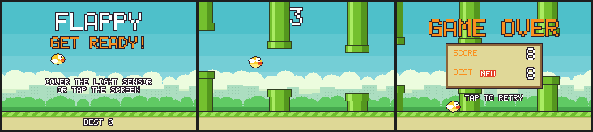

# ☁️ Cloud-Game Thin Client for ESP32-035



The game doesn't run on this board. A server on another machine (a Sipeed NanoKVM in the reference
setup) runs it and renders every frame; the CYD shows the frames over Wi-Fi and sends back one
button. The first game is a **Flappy Bird tribute**:
[Sipeed_Examples/cyd-cloud-game](https://github.com/Novice130/Sipeed_Examples/tree/main/cyd-cloud-game).

## 🧒 Start here (for students)

- **What you will see:** a Flappy-Bird-style game. Cover the light sensor on the front of the board
  with your fingertip (or tap the screen) to make the bird flap through the gaps between pipes.
- **The trick:** the game itself runs on a different computer (the **server**). It sends each
  picture to the board over **Wi-Fi** (wireless internet at home or school), and the board sends
  back your button presses. So you need that server running first; see the link above. A teacher
  may want to set this part up.
- **You need:** the board, a USB-C cable, a computer set up as in the
  [main Start here](../../README.md#-start-here-for-students), a 2.4 GHz Wi-Fi network, and the
  game server running on another machine on the same network.
- **Steps:**
  1. Copy `include/config.example.h` to a new file `include/config.h`.
  2. In `config.h`, type your Wi-Fi name, Wi-Fi password and the server's address (`GAME_HOST`).
     This file is never uploaded to GitHub, so your password stays private.
  3. Plug in the board and click **Project Tasks → env:cloud_game → Upload** in PlatformIO.
  4. The screen shows it joining Wi-Fi and connecting, then the game appears.

## 🎮 Controls

| Input | What it does |
| :--- | :--- |
| **Cover the light sensor** (fingertip on the LDR, front of the board) | Button: start, flap, retry |
| **Tap the screen** | Same button (if your touch panel works) |

Sound effects (flap, score, hit, die) play on the speaker and the RGB LED flashes green on a point,
red on a crash. The demo that plays when nobody is playing is silent.

## ✨ How it works

1. **Ask:** every frame the board sends `'F', held, presses` (a running count of presses, so a quick
   tap between frames is never lost).
2. **Receive:** the server replies with sound bits and a run-length coded 240x160 frame of palette
   indices (~5 KB: flat pixel art compresses well and stays crisp, unlike JPEG).
3. **Diff while decoding:** pixels are written into an 8-bit framebuffer of what's on the panel; any
   pixel that actually changes sets a bit for its column in its 4-row band.
4. **Push only what changed:** each band is sent as separate stretches of changed columns, 2x
   scaled, by DMA. A moving pipe only changes near its edges and stripes, so ~20% of the screen is
   redrawn per frame in play.
5. **Pipeline:** the next frame is requested before the current one is drawn, so Wi-Fi and the
   display work at the same time.

Measured on this board: **25-30 fps**, ~5 KB per frame, network wait ~13-19 ms, drawing 11-18 ms.
The full protocol is in the server's README; any game that draws into a ≤240x160 palette
framebuffer can use this client unchanged.

## 🛠️ Setup

```bash
cp examples/cloud-game/include/config.example.h examples/cloud-game/include/config.h
# edit config.h: WIFI_SSID / WIFI_PASSWORD (a 2.4 GHz network) and GAME_HOST (the server's IP)
pio run -e cloud_game -t upload
```

`config.h` is git-ignored. If the board can't join, the serial log lists the networks it can see.
It shows what it's doing on screen (joining Wi-Fi, connecting) and reconnects by itself if the
server restarts.

## 🩺 Hardware notes (learned the hard way)

- **Light sensor on the 0 dB ADC range.** At the default 11 dB range (0-3.3 V) a covered LDR sits at
  the very bottom of the scale, where the ESP32 ADC reads 0, so covers flickered and were missed.
  `analogSetPinAttenuation(34, ADC_0db)` (0-1.1 V) gives room 0, fingertip 60-500, steady.
- **Touch is read through TFT_eSPI** (`tft.getTouchRawZ()`, `TOUCH_CS` in `platformio.ini`), which
  shares the HSPI bus with the display's DMA properly. A damaged panel reads z ≈ 4100 permanently;
  readings above 3900 are ignored so it can't fake a press.

## Serial output

```
[WiFi] joined "my_network" as 192.168.0.177
[Game] 192.168.0.222:8766: 240x160 x2, 27 colours
[ESP32-035] 25.3 fps, 5.3 KB/frame, net 18.3 ms, draw 17.9 ms (21% of pixels redrawn)
```

Flappy Bird is a trademark of its owner; the game is an unaffiliated tribute with original art.

---

🤖 Working with an AI assistant? Give it [AI_PROMPT.md](../../AI_PROMPT.md).
