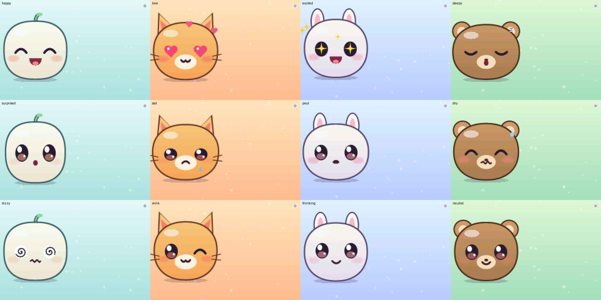
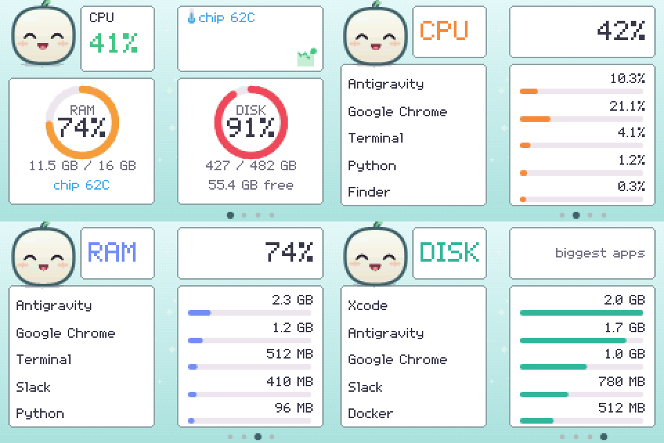

# 🍡 CYD Agent (cute desk pet + live system monitor)



Tap the pet: it reacts to how your computer is doing, then springs into the corner while live stats
slide in around it. It stays there reacting to the real numbers: calm, happy, sweating, or dizzy.



## Controls

| Input | On the pet | On the stats |
|---|---|---|
| 1 tap anywhere | Reacts, then opens the stats | Next page: overview, CPU, RAM, disk, then back to the pet |
| 2 taps anywhere | Switch friend (Mochi, Neko, Usagi, Kuma) | Back to the pet |
| No taps | Silent demo loop after 30 s | Back to the demo after 2 minutes |
| Room goes dark or bright | Falls asleep or wakes up | Same, in the corner |

**Backup button:** if the cracked glass stops reading your finger, cover the light sensor briefly for 1 tap,
or twice quickly for 2 taps. Serial `s` and `d` at 115200 baud also act like 1 tap and 2 taps.

## What the numbers mean

The board asks for a new sample every second. Animation only eases towards the latest real value, in
about half a second.

| Shown | Source |
|---|---|
| CPU % and history | Whole machine, one sample a second, drawn as a scrolling chart |
| Chip temperature | Hottest Apple Silicon die sensor. Rises under load |
| RAM | Same sum as Activity Monitor's Memory Used: app + wired + compressed |
| `chip` under RAM | The same chip reading. Unified memory has no sensor of its own, so there is **no separate RAM temperature** |
| Disk | Your main internal drive. Other drives are not included |
| Top apps: CPU and RAM | All of an app's helper processes added into one row. CPU is a share of the whole machine, so it matches the total, unlike Activity Monitor's per-core figure |
| Top apps: disk | `/Applications` (following links to other drives) plus each app's Application Support folder. Takes a while on first run, then rescans hourly |

Limits: processes owned by other users, such as root, can't be read, so they are missing from the top apps
but still count in the totals. RAM per app adds up each process's resident memory, so shared memory
can count more than once. Chip temperature uses a private macOS interface; if an update removes it, the
board shows no temperature rather than a wrong one.

## Run it

```bash
cp examples/cyd-agent/include/config.example.h examples/cyd-agent/include/config.h
# fill in Wi-Fi, your computer's IP as AGENT_HOST, and a random AGENT_TOKEN

.venv/bin/pio run -e cyd_agent -t upload

.venv/bin/python -m pip install psutil
export CYD_AGENT_TOKEN=<the same AGENT_TOKEN>
.venv/bin/python examples/cyd-agent/tools/agent_proxy.py
```

No API key or cost. The computer must stay awake and on the same network as the board.

## Optional: give it a Claude brain

```bash
.venv/bin/python -m pip install anthropic
export ANTHROPIC_API_KEY=...
.venv/bin/python examples/cyd-agent/tools/agent_proxy.py --brain
```

Now taps and light changes also go to an LLM agent loop. The model reacts by calling tools, and those tools
are the pet's body. `read_sensors` lets it see the room and your computer's load before deciding, so this
is a small ReAct loop. Use `--mock` for scripted reactions without a key.

| Tool the model calls | On the board |
|---|---|
| `set_face` | One of 12 expressions, hidden behind a blink as it changes |
| `say` | Speech bubble with typewriter text, auto-advances |
| `set_led` | Flashes the RGB LED |
| `play_sound` | Little jingle, in play mode only. **Needs a speaker plugged in** |
| `read_sensors` | Brightness, pets, uptime, computer CPU, RAM and chip temperature |

The default model is `claude-opus-5-5` at low effort; set `AGENT_MODEL=claude-haiku-5-5` for a much cheaper
pet. The proxy allows one event every 3 s and 200 a day (`AGENT_DAILY_LIMIT`), and turns on server-side
refusal fallback (`fallbacks: "default"`).

## Privacy and safety

- **The API key stays on the computer.** The board only holds a LAN token, in the git-ignored `config.h`.
- App names, your computer's stats and the token cross your LAN **unencrypted**. Anyone who sees the token
  can read those stats. Run this on a network you trust, and don't forward the port to the internet.

## Hardware notes

- **Speaker:** not on the board by default. Plug a small speaker into the speaker connector (GPIO 26).
  Everything else works without one.
- **Cracked screen:** the layout keeps everything out of a gutter around the vertical crack near the middle.
  If yours sits elsewhere, change `CRACK_X` in `include/game.h`. The crack also shorts the touch glass, so
  the firmware can tell that you pressed but not where: the whole screen is one button.
- **Light sensor:** `LDR_DARK_RAW` in `src/main.cpp` is a first guess. The serial log prints `ldr=`, so
  check the value in your dark room and adjust it.

## Edit it

- Expressions: `MOODS` in `include/game.h`, drawing in `include/face.h`.
- Dashboard layout: `drawOverview` and `drawTopPage` in `include/game.h`.
- What gets measured: `tools/system_stats.py`.
- Personality and tools: `SYSTEM` and `TOOLS` in `tools/agent_proxy.py`.
- Font: `tools/make_art.py` writes `include/art.h`.
- Preview without hardware:

```bash
cd examples/cyd-agent/tools
clang++ -std=c++17 -O2 -I../include sim.cpp -o /tmp/sim
mkdir -p /tmp/frames
/tmp/sim /tmp/frames 300 30 60:s "90:r=face love;say Hi there;led pink" 200:l=5
```
