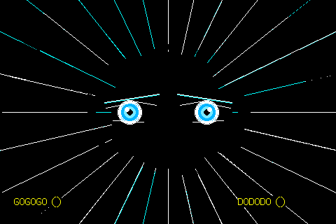

# ⚡ Manga Ultra Instinct & Speedlines for ESP32-035

## 🧒 Start here (for students)

- **What you will see:** two glowing blue anime eyes that pulse, with white and light-blue lines
  flashing out from the middle like a comic book action scene, and the words "GOGOGO" and "DODODO"
  at the bottom. The LED glows blue and light blue. It runs by itself; there is nothing to press.
- **You need:** the board, a USB-C cable and a computer set up as in the
  [main Start here](../../README.md#-start-here-for-students).
- **Steps:**
  1. Open this whole project folder in VS Code.
  2. Plug in the board with the USB cable.
  3. In PlatformIO, click **Project Tasks → env:manga_aura → Upload**.
  4. When it says `SUCCESS`, the eyes appear.
- **Try changing:** in `src/main.cpp`, the eye colour is `tft.color565(0, 180, 255)`. The three
  numbers are how much red, green and blue to mix (each 0 to 255). Try `tft.color565(255, 0, 0)`
  for red eyes, then upload again.

## ✨ Features (for the curious)

High-energy Shonen manga action animation featuring:
- Dynamic manga action speedlines radiating from center with high-intensity camera jitter.
- Glowing anime eyes with breathing iris pulse, specular glints, and eyelid arcs.
- Menacing **「ゴゴゴゴ」** *(JoJo GOGOGO)* and **「ドドドド」** *(DODODO)* floating sound effects.
- Crackling electric lightning arcs jumping across the screen.
- Synchronized electric cyan/blue RGB LED aura.

---

🤖 Working with an AI assistant? Give it [AI_PROMPT.md](../../AI_PROMPT.md).
