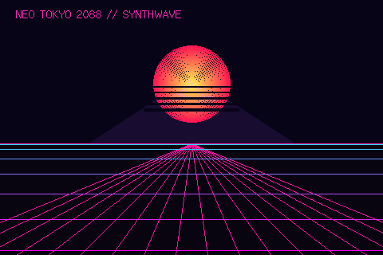

# 🌆 Neo-Tokyo 2088 Synthwave Horizon for ESP32-035

## 🧒 Start here (for students)

- **What you will see:** a glowing sunset behind a mountain, and a pink neon grid on the ground
  that keeps sliding towards you, like driving into an 80s video game. The LED glows red and purple.
  It runs by itself; there is nothing to press.
- **You need:** the board, a USB-C cable and a computer set up as in the
  [main Start here](../../README.md#-start-here-for-students).
- **Steps:**
  1. Open this whole project folder in VS Code.
  2. Plug in the board with the USB cable.
  3. In PlatformIO, click **Project Tasks → env:neo_tokyo_synthwave → Upload**.
  4. When it says `SUCCESS`, the grid starts moving.
- **Try changing:** in `src/main.cpp`, the line `gridScroll += 0.06f;` sets how fast the grid moves.
  Try `0.15f` to go faster or `0.02f` to go slower, then upload again.

## ✨ Features (for the curious)

Retro 80s Cyberpunk / Anime horizon featuring:
- 3D perspective wireframe neon grid gliding forward towards the viewer.
- Giant glowing retro anime sunset with horizontal VHS scanline cuts.
- Cyberpunk Mt. Fuji silhouette with glowing neon-pink snowcap.
- Twinkling cosmos stars in the twilight sky.

---

🤖 Working with an AI assistant? Give it [AI_PROMPT.md](../../AI_PROMPT.md).
