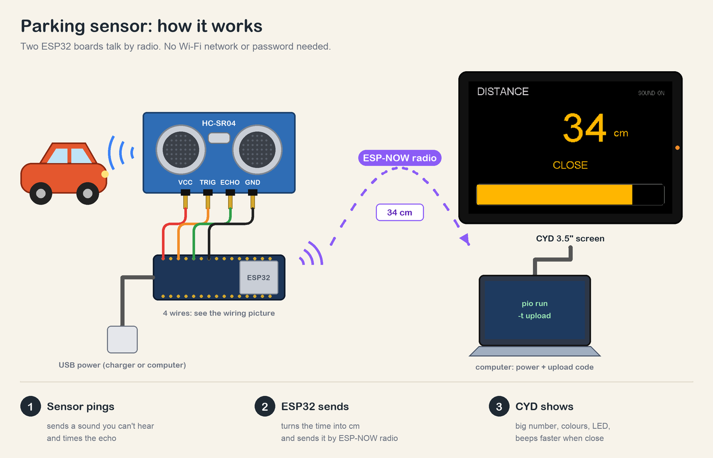
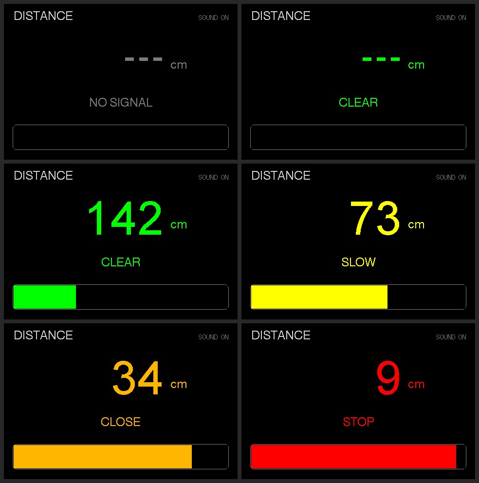
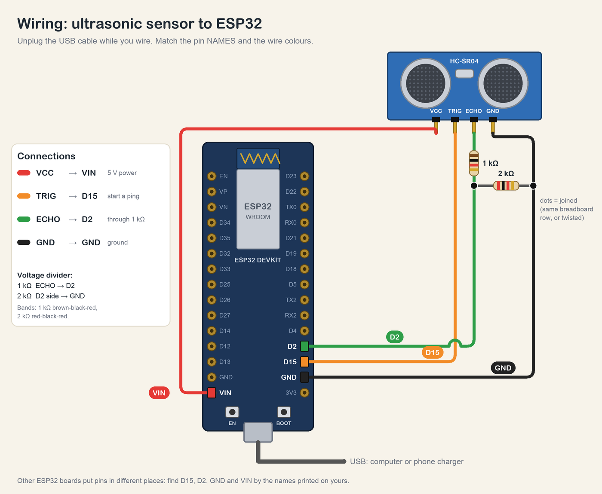

# 🚗 Parking Sensor (ultrasonic distance over ESP-NOW)



A second, plain ESP32 reads an **HC-SR04 ultrasonic sensor** and sends the distance by radio to this
board. The CYD shows it like a car's parking sensor: a big number, a coloured zone, a bar that fills
up as something gets closer, the RGB LED in the zone colour, and beeps that speed up.

## 🧒 Start here (for students)

- **What you will see:** move your hand towards the sensor. The number on the screen goes down, the
  colour goes green → yellow → orange → red, and the board beeps faster and faster.
- **How it works:** the sensor sends out a sound too high for you to hear and times how long the echo
  takes to come back. The second ESP32 turns that time into centimetres and sends it to the screen
  with **ESP-NOW** (a direct radio link between two ESP32s: no Wi-Fi network or password needed).
- **You need:** this board, any ESP32 dev board (the `esp32dev` kind), an HC-SR04 sensor, 4 jumper
  wires (plus 2 resistors, see wiring), and two USB cables.
- **Steps:**
  1. Wire the sensor to the ESP32 dev board (table below). Ask a teacher to check before plugging in.
  2. Plug in the ESP32 dev board and click **Project Tasks → env:parking_sensor_sender → Upload**.
  3. Plug in the CYD and click **Project Tasks → env:parking_sensor → Upload**.
  4. Power both. Within a second the screen leaves "NO SIGNAL" and shows the distance.



## 🔌 Wiring (sensor → ESP32 dev board)



| HC-SR04 | ESP32 dev board | Notes |
| :--- | :--- | :--- |
| VCC | **VIN (5 V)** | The classic HC-SR04 needs 5 V. On 3.3 V it reads a fake ~1 cm |
| GND | GND | |
| TRIG | **GPIO15** (D15) | 3.3 V is enough to trigger it |
| ECHO | **GPIO2** (D2) | Through a divider: ECHO → 1 kΩ → GPIO2, GPIO2 → 2 kΩ → GND |

The ECHO pulse is 5 V and the ESP32's pins are rated for 3.3 V, so the divider brings it down to
~3.3 V. A 3.3 V sensor (HC-SR04**P**, RCWL-1601) can run from 3V3 and needs no divider.
GPIO2 is also the dev board's blue LED, so it flickers with every echo. Change the pins at the top of
`sender/main.cpp`.

## 📏 Zones

| Distance | Zone | Screen / LED | Sound |
| :--- | :--- | :--- | :--- |
| nothing within ~4 m | CLEAR | green, `---` | silent |
| 100 cm and more | CLEAR | green | silent |
| 50–99 cm | SLOW | yellow | slow beeps |
| 20–49 cm | CLOSE | orange (LED yellow) | faster beeps |
| under 20 cm | STOP | red | almost one long beep under 10 cm |
| no packet for 1 s | NO SIGNAL | grey, LED blue | silent |

Beeps come every `cm × 8` ms below 1 m. **Tap the screen** to turn the sound off or on. The bar is
empty at 2 m and full at 0 (`BAR_RANGE_CM`).

## ✨ How it works

1. **Ping:** the sender fires a 10 µs pulse on TRIG every 60 ms (old echoes need that long to fade)
   and times the ECHO pulse with `pulseIn()`: 58 µs per cm, there and back.
2. **Filter:** the median of the last 3 readings throws away single bad echoes without lag.
3. **Send:** a 10-byte packet (`include/packet.h`: magic, sequence, millimetres) is broadcast over
   ESP-NOW to `FF:FF:FF:FF:FF:FF`, so no MAC addresses have to be paired. Both boards stay on Wi-Fi
   channel 1 and never join a network.
4. **Show:** the CYD redraws only what changed (number, zone label, bar), so it never flickers.

## 🛠️ Build

```bash
pio run -e parking_sensor_sender -t upload --upload-port <esp32-dev-port>
pio run -e parking_sensor -t upload --upload-port <cyd-port>
```

With both boards plugged in, PlatformIO can't guess which is which, so pass `--upload-port`
(`ls /dev/cu.usbserial-*` on a Mac, `COM3`-style names on Windows).

The screenshots come from the desktop emulator: `tools/emu_feed.cpp` plays the sender's part
(no signal, then an object coming closer) so `tools/cyd-emu/shoot.sh` can capture every zone.
The overview and wiring pictures are drawn by `tools/make_diagrams.py` (Python + Pillow), so the pin
names are exact; edit it and re-run to change them.

## Serial output

Sender (`pio device monitor -p <esp32-dev-port>`):

```
[SONAR] ready, TRIG=15 ECHO=2, MAC 24:6F:28:xx:xx:xx
[SONAR] 34.2 cm
[SONAR] no echo
```

CYD (once a second):

```
[PARK] display ready, MAC 24:6F:28:xx:xx:xx
[PARK] 34 cm (CLOSE)
[PARK] no signal from sender
```

The line `E ledc: ledc_get_duty(745): LEDC is not initialized` at the first beep is harmless (the
core's `tone()` checks the channel before setting it up).

## 💡 Ideas

- Add a PIR motion sensor to the sender and wake the screen only when someone walks in.
- Mount the sender on a wall and the CYD on the dashboard: a real garage parking aid.
- Swap the sensor: any reading that fits in a small packet (temperature, light, a button) can use the
  same ESP-NOW link.

---

🤖 Working with an AI assistant? Give it [AI_PROMPT.md](../../AI_PROMPT.md).
