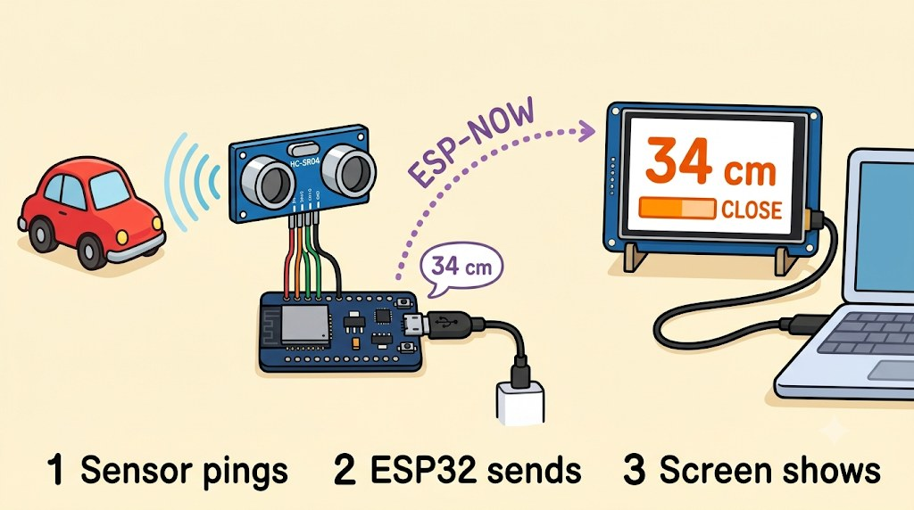

# 🚗 Parking Sensor (ultrasonic distance + PIR motion over ESP-NOW)



A second, plain ESP32 reads an **HC-SR04 ultrasonic sensor** and an **HC-SR501 PIR motion sensor**
and sends both by radio to this board. The CYD shows the distance like a car's parking sensor: a big
number, a coloured zone, a bar that fills up as something gets closer, the RGB LED in the zone colour,
and beeps that speed up. A pink **MOTION** badge lights up when the PIR sees someone, and the screen
goes to sleep when nobody is around.

## 🧒 Start here (for students)

- **What you will see:** move your hand towards the sensor. The number on the screen goes down, the
  colour goes green → yellow → orange → red, and the board beeps faster and faster. Wave in front of
  the white dome and **MOTION** lights up at the top.
- **How it works:** the sensor sends out a sound too high for you to hear and times how long the echo
  takes to come back. The second ESP32 turns that time into centimetres and sends it to the screen
  with **ESP-NOW** (a direct radio link between two ESP32s: no Wi-Fi network or password needed).
  The PIR sensor sees the warmth of a moving body through its white dome.
- **You need:** this board, any ESP32 dev board (the `esp32dev` kind), an HC-SR04 sensor, an
  HC-SR501 PIR sensor, jumper wires, 2 resistors (see wiring), and two USB cables. A small breadboard
  makes the shared wires easy.
- **Steps:**
  1. Wire the sensor to the ESP32 dev board (table below). Ask a teacher to check before plugging in.
  2. Plug in the ESP32 dev board and click **Project Tasks → env:parking_sensor_sender → Upload**.
  3. Plug in the CYD and click **Project Tasks → env:parking_sensor → Upload**.
  4. Power both. Within a second the screen leaves "NO SIGNAL" and shows the distance. The PIR
     needs about **1 minute to warm up** after power-on; until then it may say MOTION all the time.


## 🔌 Wiring (sensors → ESP32 dev board)


| HC-SR04 | ESP32 dev board | Notes |
| :--- | :--- | :--- |
| VCC | **VIN (5 V)** | The classic HC-SR04 needs 5 V. On 3.3 V it reads a fake ~1 cm |
| GND | GND | |
| TRIG | **GPIO15** (D15) | 3.3 V is enough to trigger it |
| ECHO | **GPIO2** (D2) | Through a divider: ECHO → 1 kΩ → GPIO2, GPIO2 → 2 kΩ → GND |

| HC-SR501 PIR | ESP32 dev board | Notes |
| :--- | :--- | :--- |
| VCC | **VIN (5 V)**, shared with the HC-SR04 | Needs 5 V: on 3.3 V it can stick on MOTION |
| OUT | **GPIO4** (D4) | 3.3 V output, safe to connect directly |
| GND | GND, shared | |

**Which PIR pin is which?** The labels are printed under the white dome (it pulls off). Seen from the
back with the pins on the left, they are VCC (next to the small diode), OUT (middle), GND. Swapping
VCC and GND doesn't break it (the diode blocks the power), but the output then reads MOTION forever.
For testing, turn both orange knobs fully anticlockwise (shortest hold time, about 3 s) and set the
yellow jumper to **L**.

The ECHO pulse is 5 V and the ESP32's pins are rated for 3.3 V, so the divider brings it down to
~3.3 V. A 3.3 V sensor (HC-SR04**P**, RCWL-1601) can run from 3V3 and needs no divider.
GPIO2 is also the dev board's blue LED, so it flickers with every echo. Change the pins at the top of
`sender/main.cpp`.

## 📏 Zones

| Distance | Zone | Screen / LED | Sound |
| :--- | :--- | :--- | :--- |
| nothing within ~4 m | CLEAR | green, `---` | silent |
| 100 cm and more | CLEAR | green | silent |
| 50–99 cm | SLOW | yellow | slow beeps |
| 20–49 cm | CLOSE | orange (LED yellow) | faster beeps |
| under 20 cm | STOP | red | almost one long beep under 10 cm |
| no packet for 1 s | NO SIGNAL | grey, LED blue | silent |

Beeps come every `cm × 8` ms below 1 m. **Tap the screen** to turn the sound off or on. The bar is
empty at 2 m and full at 0 (`BAR_RANGE_CM`).

**Sleep:** after a minute with no motion, nothing within 1 m and no tap (`SLEEP_AFTER_MS`), the
backlight and LED turn off and the beeps stop. Motion, something within 1 m or a tap wakes it; the
waking tap doesn't toggle the sound.

## ✨ How it works

1. **Ping:** the sender fires a 10 µs pulse on TRIG every 60 ms (old echoes need that long to fade)
   and times the ECHO pulse with `pulseIn()`: 58 µs per cm, there and back.
2. **Filter:** the median of the last 3 readings throws away single bad echoes without lag. Echoes
   under 2 cm count as "no echo" (too close to measure, or the sensor is unplugged).
3. **Send:** an 11-byte packet (`include/packet.h`: magic, sequence, millimetres, PIR state) is broadcast over
   ESP-NOW to `FF:FF:FF:FF:FF:FF`, so no MAC addresses have to be paired. Both boards stay on Wi-Fi
   channel 1 and never join a network.
4. **Show:** the CYD redraws only what changed (number, zone label, bar), so it never flickers.

## 🛠️ Build

```bash
pio run -e parking_sensor_sender -t upload --upload-port <esp32-dev-port>
pio run -e parking_sensor -t upload --upload-port <cyd-port>
```

With both boards plugged in, PlatformIO can't guess which is which, so pass `--upload-port`
(`ls /dev/cu.usbserial-*` on a Mac, `COM3`-style names on Windows).

The screenshots come from the desktop emulator: `tools/emu_feed.cpp` plays the sender's part
(no signal, then an object coming closer while the PIR sees motion) so `tools/cyd-emu/shoot.sh` can capture every zone.
The wiring picture is drawn by `tools/make_diagrams.py` (Python + Pillow), so the pin names are
exact; edit it and re-run to change it. The cartoon overview (`docs/overview.jpg`) was made with an
AI image generator; `make_diagrams.py overview` draws an exact version to `docs/overview-drawn.png`.

## Serial output

Sender (`pio device monitor -p <esp32-dev-port>`):

```
[SONAR] ready, TRIG=15 ECHO=2 PIR=4, MAC 24:6F:28:xx:xx:xx
[SONAR] 34.2 cm
[SONAR] 33.8 cm  [PIR] motion
[SONAR] no echo
```

CYD (once a second):

```
[PARK] display ready, MAC 24:6F:28:xx:xx:xx
[PARK] 34 cm (CLOSE), motion
[PARK] sleep
[PARK] wake
[PARK] no signal from sender
```

The line `E ledc: ledc_get_duty(745): LEDC is not initialized` at the first beep is harmless (the
core's `tone()` checks the channel before setting it up).

## 💡 Ideas

- Count how many times the PIR saw someone today and show it on the screen.
- Mount the sender on a wall and the CYD on the dashboard: a real garage parking aid.
- Swap the sensor: any reading that fits in a small packet (temperature, light, a button) can use the
  same ESP-NOW link.

---

🤖 Working with an AI assistant? Give it [AI_PROMPT.md](../../AI_PROMPT.md).
