# ⏳ The Hourglass Timer: an explainer for students

This little computer is a **timer that looks like an hourglass**. It helps you work for a while, then
reminds you to rest. There are seven different hourglasses to pick from, and one of them holds a whole
galaxy!

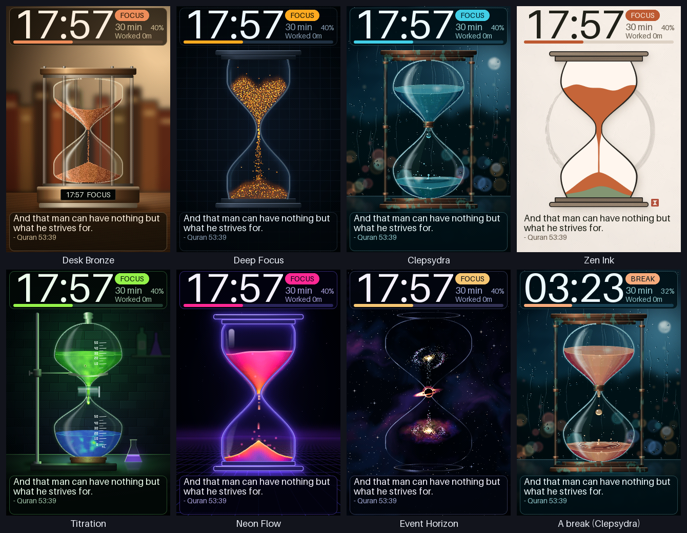

> The screen pictures on this page come from the real timer program, running on a computer. They show
> exactly what the program draws on the screen.

## 🍅 Why a timer helps you

Back in the 1980s, a student named Francesco Cirillo had trouble paying attention while studying. The
answer was a kitchen timer shaped like a tomato, and a simple deal: *"I will work until it rings, and
then I can rest."* It worked! The word for tomato in Italian is **pomodoro**, so people call this
the **Pomodoro method**.

The steps are easy:

1. Pick one job, like your reading or your maths.
2. Work on only that job until the timer ends.
3. Take a short rest.
4. Start again.

Your brain is a bit like a runner. It goes further with short rests than with no rest at all.

## 👀 Everything on the screen

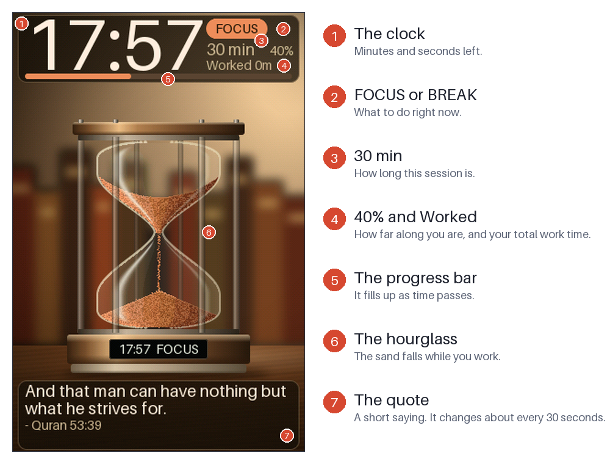

## 🔄 One whole work session

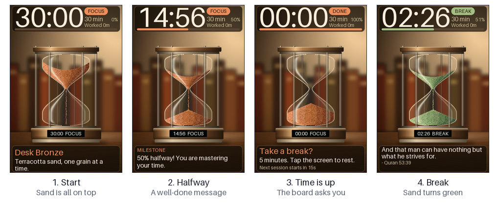

The board plays little sounds and flashes its coloured light when something happens.

How long is the rest? The program decides using a simple rule:

| If you worked for... | You rest for... |
| :--- | :--- |
| 30 minutes or less | 5 minutes |
| 31 to 60 minutes | 10 minutes |
| 61 to 90 minutes | 15 minutes |
| more than 90 minutes | 20 minutes |

Computers make choices with rules like this one. Programmers call them **if statements**: *if you
worked 30 minutes or less, then rest 5 minutes.*

## 👆 How to control it

You only need the screen and one tiny sensor.

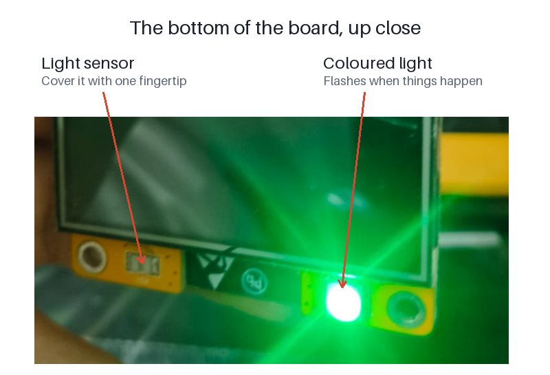

| What you do | What happens |
| :--- | :--- |
| **Tap the screen** while working | Picks the next time (1, 5, 10, 15, 20, 25, 30, 45, 60, 75, 90, 105 or 120 minutes). The clock starts again from the top! |
| **Tap the screen** when it asks about a break | Starts your break |
| **Tap the screen** during a break | Ends the break and goes back to work |
| **Hold your finger on the screen** for about 1 second | Next hourglass |
| **Cover the light sensor** quickly | Next hourglass |
| **Cover the light sensor** for 2 to 4 seconds | Starts the session again |
| **Cover the light sensor** for 5 seconds | Pause. Do it again, or tap the screen, to carry on |

If you do nothing when the board asks about a break, it waits 15 seconds and starts the next work session.

## 🎨 The seven hourglasses

Each one has some real science or history behind it.

<table>
<tr>
<td width="25%">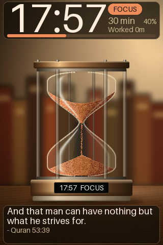</td>
<td width="25%">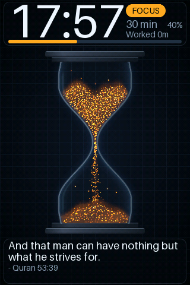</td>
<td width="25%">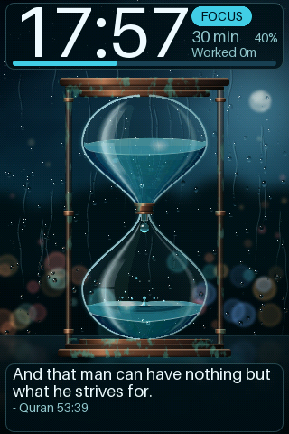</td>
<td width="25%">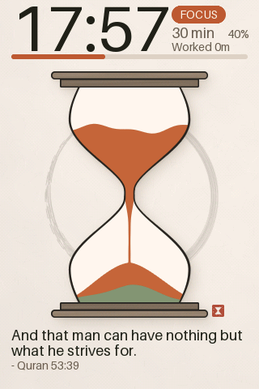</td>
</tr>
<tr valign="top">
<td><b>Desk Bronze</b><br>Sand on a wooden desk. Bronze is a metal made by mixing copper and tin.</td>
<td><b>Deep Focus</b><br>About 3,200 tiny glowing embers. Embers glow because they are very hot.</td>
<td><b>Clepsydra</b> (say <i>KLEP-sih-druh</i>)<br>A water clock. People told time with dripping water thousands of years ago, in places like ancient Egypt.</td>
<td><b>Zen Ink</b><br>Looks like a printed picture. The faint ring behind it is an <i>enso</i>, a circle from Japanese brush painting.</td>
</tr>
<tr>
<td>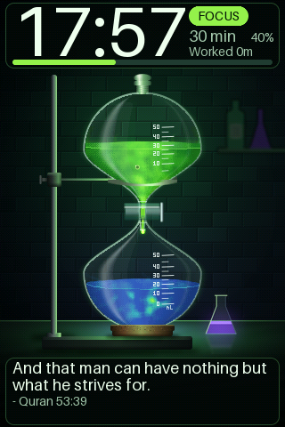</td>
<td>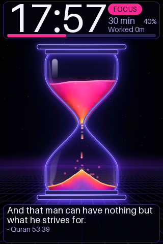</td>
<td>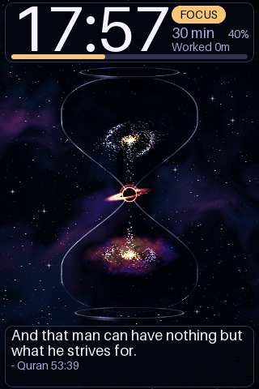</td>
<td></td>
</tr>
<tr valign="top">
<td><b>Titration</b><br>Chemists add a liquid drop by drop until the colour suddenly changes. That is how they measure what is in a liquid.</td>
<td><b>Neon Flow</b><br>Real neon signs glow because electricity passes through a gas inside the tube.</td>
<td><b>Event Horizon</b><br>A galaxy falls into a black hole. The event horizon is its edge: past it, not even light can get out.</td>
<td></td>
</tr>
</table>

## 🔬 How it works inside

### 1. The picture is made of tiny dots

The screen is a grid of tiny coloured dots called **pixels**. It is 320 dots wide and 480 dots tall.

**Maths time:** 320 × 480 = **153,600 pixels**, all on a screen smaller than your hand.

### 2. It is a very fast flipbook

Nothing on a screen really moves! The computer shows one still picture, then another, then another. Each
picture is called a **frame**. Your eyes blend them together, just like the pages of a flipbook.

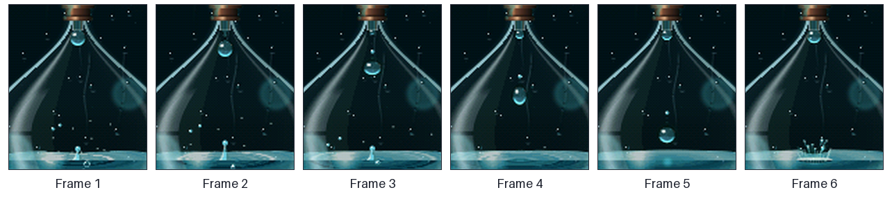

This board draws **30 frames every second**. So it has only 1/30 of a second to make each one, and it
finishes with time to spare.

### 3. Each frame is built in layers

Think of paper cut-outs stacked on a table. The back never moves, the sand changes, and the glass goes on top.

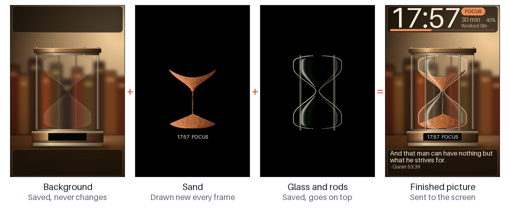

This is the clever part. The computer is small, and it cannot redraw 153,600 pixels 30 times a second and
still have time for anything else. So it **saves the parts that never change**, and only redraws the small
area around the glass. It only sends the pieces that changed to the screen, and that saves a lot of time.

### 4. The sand follows real maths

Look at how the top of the sand moves:

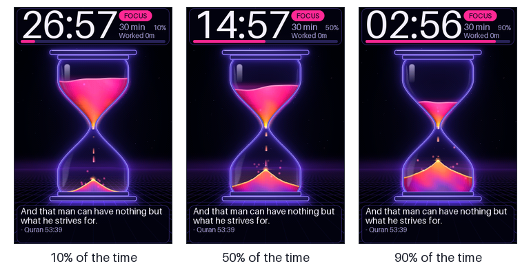

From 10% to 50% is a lot of time, but the level only drops a little. In the narrow part near the middle,
it drops much faster. Why? Each row of a wide part holds a lot of sand, and each row of a narrow part holds
only a little. The same amount of sand falls every second, so narrow rows empty faster.

The program measures the real shape of the glass to work this out, so the sand moves the way real sand does.

> **Try it:** pour water slowly into a funnel or an ice cream cone held point down. Does the water go up faster
> near the point or near the wide top?

### 5. A broken screen became a good idea

The board we used to build this has a crack, and its screen shows a thin line. The program turns the
picture to stand up tall, so the line now goes side to side. Then we put the **thinnest part of the
hourglass right on the line**, and kept all the words far away from it.

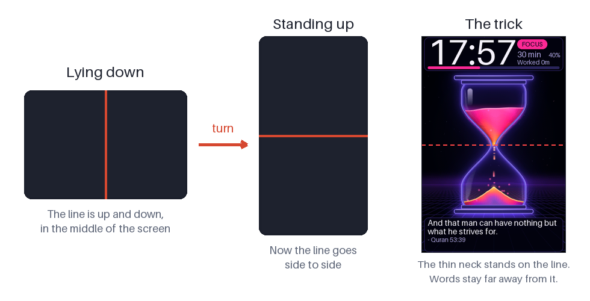

Engineers do this all the time: when you cannot fix a problem, design around it.

### 6. The light sensor stopped telling fibs

While testing, the timer kept pausing all by itself, with nobody touching it! So we had the board print out
what its light sensor was reading. We found two problems:

- The very first reading after switching on was far too low, so the board thought a finger was covering it.
- In a dim room the readings jump up and down a lot, and those jumps looked like a finger too.

The fix was to **wait a moment after switching on, and to use the average of many readings**, not just one.
Scientists do the same when they repeat a measurement. Finding this was just like a science experiment:
look at the evidence first, then fix the problem.

## 🛠️ Change it yourself

The program is written in a language called **C++**. Ask a grown-up to help you install the tools from the
[main guide](../../README.md), then try one of these. Change one small thing, upload it, and see what happens.

**Add your own quote.** Open [`include/quotes.h`](include/quotes.h) and add a line to the list. Keep it short, so that it fits in the box:

```cpp
{"Practice makes progress.", "My Teacher"},
```

**Change the starting time.** Open [`include/pomodoro.h`](include/pomodoro.h) and find these lines:

```cpp
static const uint16_t DURATIONS_MIN[] = {1, 5, 10, 15, 20, 25, 30, 45, 60, 75, 90, 105, 120};
static const uint8_t DEFAULT_DURATION_INDEX = 6;
```

The first line is a **list**. Computers count from 0, so number 0 in the list is `1` and number 6 is `30`.
Which number do you need to start at 25 minutes? Change the `6` and find out if you were right.

**Change the break rule.** Look for `calcBreakSec` in the same file. Can you make every break 10 minutes?

## 📖 Words to know

| Word | What it means |
| :--- | :--- |
| **Pixel** | One tiny coloured dot on a screen |
| **Frame** | One still picture out of many that make something look like it moves |
| **Layer** | One part of a picture that is stacked on top of other parts |
| **Sensor** | A part that lets a computer notice the world, like light or touch |
| **If statement** | A rule that tells a computer what to do: if this happens, then do that |
| **Average** | One number that sums up many numbers: add them all, then divide by how many there are |
| **Upload** | Sending a program from your computer to the board |

## 👩‍🏫 For teachers

- **Install:** from the repository root, run `.venv/bin/pio run -e pomodoro_hourglass -t upload`. Full build notes are in the [README](README.md).
- **Upside-down picture?** Change `tft.setRotation(0)` to `tft.setRotation(2)` in [`src/main.cpp`](src/main.cpp).
- **Good discussion questions:** Why save the background instead of drawing it every time? What other rule could decide the length of a break? Which other problems could you solve by designing around them?
- All the art is made by code, with no copied images. The quotes are in `include/quotes.h` and are easy to change or replace for your class.
