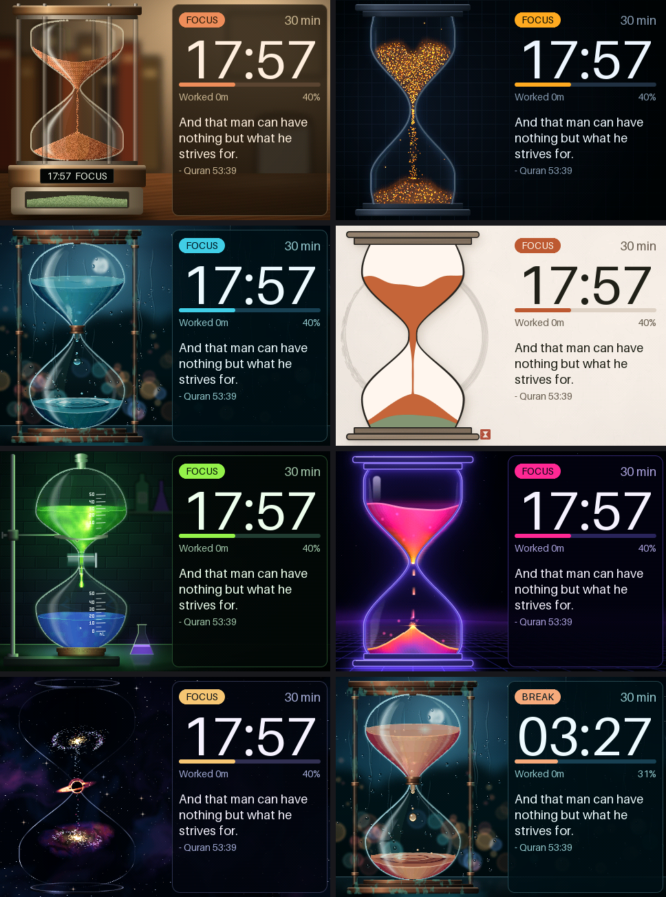
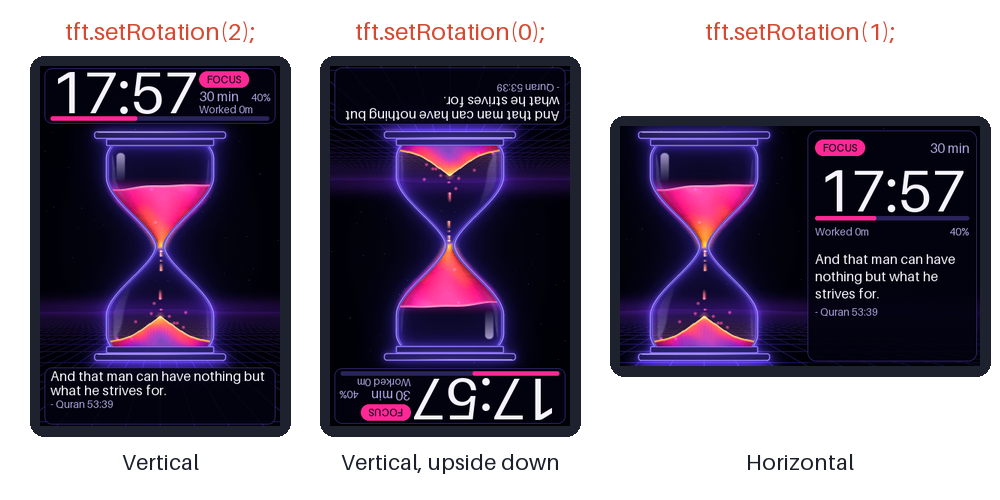

# Pomodoro Hourglass for ESP32-035 (CYD 3.5")

A focus timer with seven animated hourglass scenes, standing up in portrait at the panel's native 320x480 at 30 fps. It keeps the quotes, milestone praise, smart break prompt and worked-time counter.

**🧒 For students:** read the [explainer with all the pictures](EXPLAINER.md).



## All the features

- **Vertical or horizontal:** Rotation 2 or 0 in this folder, rotation 1 in [the horizontal version](../pomodoro-hourglass-horizontal/). See [Vertical and horizontal](#vertical-and-horizontal).
- **Seven hourglass scenes:** fine sand, embers, water drops, ink, a chemical titration, neon plasma and a black hole, all at 30 fps.
- **Sand that tells the time:** the level follows the clock, using the real shape of each glass.
- **Thirteen session lengths:** 1 to 120 minutes, 30 by default. Tap the screen to pick the next one.
- **Stop and start with the light sensor:** hold a finger on it for **5 s to stop** the timer, and for **2 s to start again**. If it is stopped, it carries on from where it stopped. If it is running, the session restarts from the top.
- **Next scene:** cover the light sensor briefly, or hold the screen for about a second.
- **Break question:** at the end of a session it asks if you want a break. Tap to rest, or wait 15 s to start the next session.
- **Smart break length:** 5 minutes after up to 30 minutes of work, then 10, 15 and 20 minutes for longer sessions.
- **Break colours:** each scene changes colour during a break.
- **Progress:** a big clock, a progress bar, the percent done and your total time worked.
- **Quotes and praise:** a new quote about every 30 seconds, and a message at every 10% of a session.
- **Sound and light:** chimes, and the coloured light flashes when things happen.
- **Works with a cracked screen:** the layout stays clear of the crack, and touch still works with the shorted glass.

## Scenes

| Scene | What flows through the glass | Break colour |
| :--- | :--- | :--- |
| **Desk Bronze** | Fine terracotta sand on a sunlit desk. Grains crawl into the funnel, fall as a mottled thread, then bounce and roll down the pile. | Sage |
| **Deep Focus** | A swarm of about 3200 twinkling amber embers, with sparks drifting upward. | Ice blue |
| **Clepsydra** | Water drops swell, pinch off with a satellite drop and act as tiny lenses. Impacts make crowns, ripples and bubbles under moving caustics. | Rose gold |
| **Zen Ink** | Flat printed design on paper: a slow sienna wave and a breathing thread over a sage mound. | Jade |
| **Titration** | Glowing reagent drips through a stopcock. Clouds bloom and shift the flask from violet to green, then a magenta endpoint wave sweeps it near the end. | Cobalt |
| **Neon Flow** | Magenta-to-orange plasma, falling light dashes, flares on a glowing mound. | Cyan |
| **Event Horizon** | A spiral galaxy drains through a tiny black hole and is reborn as a nebula below. | Aurora green |

## Controls

| Action | Focus | Take-a-break question | Break |
| :--- | :--- | :--- | :--- |
| **Tap the screen** | Next duration, restarts the timer | Start the break | End the break |
| **Hold the screen 1.2 s** | Next scene | Next scene | Next scene |
| **Cover the light sensor briefly** | Next scene | Next scene | Next scene |
| **Hold a finger on the light sensor for 5 s** | Stops the timer | Stops the timer | Stops the timer |
| **Hold a finger on the light sensor for 2 s, when stopped** | Starts again from where it stopped | Starts again | Starts again |
| **Hold a finger on the light sensor for 2 s, when running** | Restarts the session from the top | Start a new session | Start a new session |
| **Nothing** | Keeps flowing | Next session after 15 s | Back to focus when it ends |

The 5 s hold acts as soon as 5 s is up, and the chip then says PAUSED. The 2 s hold acts when you lift your finger, for any hold from 1.5 s up to 5 s. Holding 5 s again while stopped changes nothing. A tap also starts it again when stopped. Durations: 1, 5, 10, 15, 20, 25, 30 (default), 45, 60, 75, 90, 105, 120 minutes. Breaks: 5 minutes up to 30-minute sessions, then 10, 15 and 20 minutes.

Serial test keys at 115200 baud: `n` next scene, `s` the 5 s hold, `g` the 2 s hold, `h` jump to halfway, `b` start a break, `w` restart focus.

## Vertical and horizontal

The timer comes in two versions. Pick the one that matches how you stand the board.



| Way | `tft.setRotation()` | Screen | Code | Upload with |
| :--- | :---: | :--- | :--- | :--- |
| **Vertical** (default) | `2` | 320x480 | this folder | `-e pomodoro_hourglass` |
| **Vertical, upside down** | `0` | 320x480 | this folder, one number changed | `-e pomodoro_hourglass` |
| **Horizontal** | `1` | 480x320 | [`../pomodoro-hourglass-horizontal/`](../pomodoro-hourglass-horizontal/) | `-e pomodoro_hourglass_horizontal` |

Run these from the root of the repository. If more than one board is plugged in, add `--upload-port /dev/cu.usbserial-XXXX` and check that the `MAC:` line in the upload log is the board you mean.

### Vertical: turn the picture upside down

1. Open `src/main.cpp` in this folder and find this line in `setup()`:
   ```cpp
   tft.setRotation(2);
   ```
2. Change the `2` to a `0`, or the `0` back to a `2`:
   ```cpp
   tft.setRotation(0);
   ```
3. Upload it, then look at the screen. The serial log at 115200 baud also prints `[ESP32-035] Screen rotation 0`:
   ```bash
   .venv/bin/pio run -e pomodoro_hourglass -t upload
   ```

The crack stays on the hourglass neck both ways, because the neck is at the middle of the screen.

### Horizontal: use the other folder

Do not type `1` into this folder's `main.cpp`. The pictures here are made for a tall screen, so on a wide screen they would not fit. The horizontal version has its own pictures and layout, and it already uses `tft.setRotation(1)`:

```bash
.venv/bin/pio run -e pomodoro_hourglass_horizontal -t upload
```

To go back to vertical, upload `-e pomodoro_hourglass` again. Rotation `3` is not used.

Leave `ts.setRotation(1)` alone in both versions. Touch only tells tap from no tap, and `touchDown()` measures the crack short on that axis.

## Build and flash

```bash
.venv/bin/pio run -e pomodoro_hourglass -t upload
```

The env uses `huge_app.csv` (3 MB app) because the art takes about 2.2 MB of flash, and QIO flash at 80 MHz because the background and front layer are read from flash every frame. In DIO at 40 MHz one frame took 29.5 ms; in QIO at 80 MHz, with the tile push added, it took 13.3 ms. If a board does not boot in QIO, set `board_build.flash_mode = dio` in `platformio.ini`: it will still run, but heavier scenes may lose frames.

## How it works

- **Art in flash:** each scene has a full-screen background and a front layer (rods, highlights), pre-rendered in Python and written to `include/art/<scene>.h`.
- **Each frame:** only the rectangle around the glass is rebuilt in RAM: copy background, scene draws, front layer on top. It is cut into tiles and only changed tiles go over SPI.
- **Real sand levels:** `GlassVolume` in `hg_core.h` computes levels from the glass shape, so a bulb drains slowly in the wide part and quickly in the narrow part.
- **Restart:** the charge rushes back up instead of teleporting.
- **Hero space:** scenes draw with y counted from `art.oy`, not from the top of the screen, so a glass can move up or down without touching its scene code.
- **Cracked panel:** in portrait the crack is a horizontal line at y=240. The neck of every glass stands on it, the clock card sits above the glass and the quote card below it.
- **Text:** anti-aliased Aileron (CC0, bundled with Pillow), generated by `tools/make_fonts.py`.

## Edit or add a scene

Python 3 + Pillow on the computer. A scene is two files: `tools/art_<name>.py` and `include/scenes/<name>.h`. To add one, also add it to `include/scenes.h`. A script paints the full-screen background in screen coordinates, calls `hero_view()`, then paints the hourglass in hero space.

```bash
cd examples/pomodoro-hourglass
python3 tools/art_bronze.py          # regenerate the art
tools/try_scene.sh bronze /tmp/out p=0.02 shot=a p=0.5 shot=b break p=0.3 shot=c bench
```

`try_scene.sh` runs the real engine on the Mac against a fake panel and writes PNGs plus `sheet.png`. The commands are listed at the top of `tools/sim.cpp`. `python3 tools/make_explainer_pics.py` remakes every picture in the explainer and `docs/screens.png`. Flash space is the limit: each scene costs 307 KB, and seven scenes fill 92 % of the partition, so an eighth will not fit.

All art is procedural and hand-made in code, no copied images.
