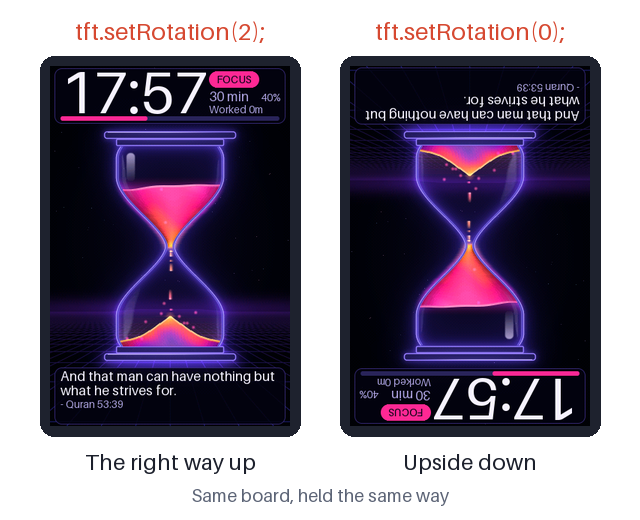

# Pomodoro Hourglass for ESP32-035 (CYD 3.5")

A focus timer with seven animated hourglass scenes, standing up in portrait at the panel's native 320x480 at 30 fps. It keeps the quotes, milestone praise, smart break prompt and worked-time counter.

**🧒 For students:** read the [explainer with all the pictures](EXPLAINER.md).


## Scenes

| Scene | What flows through the glass | Break colour |
| :--- | :--- | :--- |
| **Desk Bronze** | Fine terracotta sand on a sunlit desk. Grains crawl into the funnel, fall as a mottled thread, then bounce and roll down the pile. | Sage |
| **Deep Focus** | A swarm of about 3200 twinkling amber embers, with sparks drifting upward. | Ice blue |
| **Clepsydra** | Water drops swell, pinch off with a satellite drop and act as tiny lenses. Impacts make crowns, ripples and bubbles under moving caustics. | Rose gold |
| **Zen Ink** | Flat printed design on paper: a slow sienna wave and a breathing thread over a sage mound. | Jade |
| **Titration** | Glowing reagent drips through a stopcock. Clouds bloom and shift the flask from violet to green, then a magenta endpoint wave sweeps it near the end. | Cobalt |
| **Neon Flow** | Magenta-to-orange plasma, falling light dashes, flares on a glowing mound. | Cyan |
| **Event Horizon** | A spiral galaxy drains through a tiny black hole and is reborn as a nebula below. | Aurora green |

## Controls

| Action | Focus | Take-a-break question | Break |
| :--- | :--- | :--- | :--- |
| **Tap the screen** | Next duration, restarts the timer | Start the break | End the break |
| **Hold the screen 1.2 s** | Next scene | Next scene | Next scene |
| **Cover the light sensor briefly** | Next scene | Next scene | Next scene |
| **Cover the light sensor 1.5-5 s** | Restart session | Start a new session | Start a new session |
| **Cover the light sensor 5 s or more** | Pause or resume | Pause or resume | Pause or resume |
| **Nothing** | Keeps flowing | Next session after 15 s | Back to focus when it ends |

A tap also resumes when paused. Durations: 1, 5, 10, 15, 20, 25, 30 (default), 45, 60, 75, 90, 105, 120 minutes. Breaks: 5 minutes up to 30-minute sessions, then 10, 15 and 20 minutes.

Serial test keys at 115200 baud: `n` next scene, `h` jump to halfway, `b` start a break, `w` restart focus.

## Turn the picture upside down

The picture can stand either way up, so you can choose which end of the board goes on top. This project ships with rotation `2`.



1. Open `src/main.cpp` and find this line in `setup()`:
   ```cpp
   tft.setRotation(2);
   ```
2. Change the `2` to a `0`:
   ```cpp
   tft.setRotation(0);
   ```
3. Upload it from the root of the repository. If more than one board is plugged in, name the port, and check that the `MAC:` line in the upload log is the board you mean:
   ```bash
   .venv/bin/pio run -e pomodoro_hourglass -t upload --upload-port /dev/cu.usbserial-XXXX
   ```
4. Look at the screen. The serial log at 115200 baud also prints `[ESP32-035] Screen rotation 0`.

To change it back, put the `2` back and upload again. Only `2` and `0` stand the picture up: `1` and `3` lay it on its side, and the art is not made for that.

Leave `ts.setRotation(1)` alone. Touch only tells tap from no tap, and `touchDown()` measures the crack short on that axis. The crack stays on the hourglass neck both ways, because the neck is at the middle of the screen.

## Build and flash

```bash
.venv/bin/pio run -e pomodoro_hourglass -t upload
```

The env uses `huge_app.csv` (3 MB app) because the art takes about 2.2 MB of flash, and QIO flash at 80 MHz because the background and front layer are read from flash every frame. In DIO at 40 MHz one frame took 29.5 ms; in QIO at 80 MHz, with the tile push added, it took 13.3 ms. If a board does not boot in QIO, set `board_build.flash_mode = dio` in `platformio.ini`: it will still run, but heavier scenes may lose frames.

## How it works

- **Art in flash:** each scene has a full-screen background and a front layer (rods, highlights), pre-rendered in Python and written to `include/art/<scene>.h`.
- **Each frame:** only the rectangle around the glass is rebuilt in RAM: copy background, scene draws, front layer on top. It is cut into tiles and only changed tiles go over SPI.
- **Real sand levels:** `GlassVolume` in `hg_core.h` computes levels from the glass shape, so a bulb drains slowly in the wide part and quickly in the narrow part.
- **Restart:** the charge rushes back up instead of teleporting.
- **Hero space:** scenes draw with y counted from `art.oy`, not from the top of the screen, so a glass can move up or down without touching its scene code.
- **Cracked panel:** in portrait the crack is a horizontal line at y=240. The neck of every glass stands on it, the clock card sits above the glass and the quote card below it.
- **Text:** anti-aliased Aileron (CC0, bundled with Pillow), generated by `tools/make_fonts.py`.

## Edit or add a scene

Python 3 + Pillow on the computer. A scene is two files: `tools/art_<name>.py` and `include/scenes/<name>.h`. To add one, also add it to `include/scenes.h`. A script paints the full-screen background in screen coordinates, calls `hero_view()`, then paints the hourglass in hero space.

```bash
cd examples/pomodoro-hourglass
python3 tools/art_bronze.py          # regenerate the art
tools/try_scene.sh bronze /tmp/out p=0.02 shot=a p=0.5 shot=b break p=0.3 shot=c bench
```

`try_scene.sh` runs the real engine on the Mac against a fake panel and writes PNGs plus `sheet.png`. The commands are listed at the top of `tools/sim.cpp`. `python3 tools/make_explainer_pics.py` remakes every picture in the explainer and `docs/screens.png`. Flash space is the limit: each scene costs 307 KB, and seven scenes fill 92 % of the partition, so an eighth will not fit.

All art is procedural and hand-made in code, no copied images.
