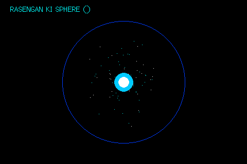

# 🌀 Rasengan Ki Energy Vortex for ESP32-035

3D particle physics visualization featuring:
- 90+ high-speed particles swirling in a dense 3D spherical vortex.
- Concentric glowing energy rings rotating at opposing angles.
- Expanding shockwave rings pulsing outward and dissipating.
- Dynamic pulsating white/cyan energy core.
