# 🖥️ Screen Mirror: your computer's screen on the little yellow display

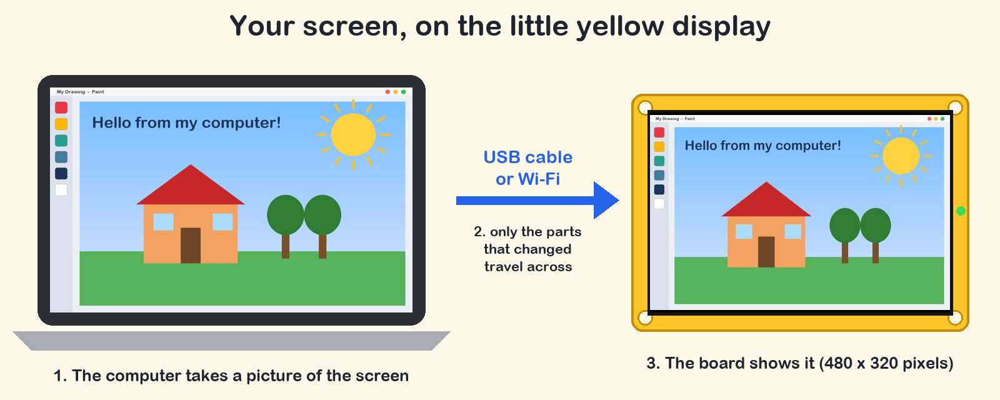

Whatever is on your computer (a drawing, a video, a game, a slideshow) shows up live on the
ESP32 "Cheap Yellow Display". You set it all up from a **website**: no programs to download.

> 💡 **Thank you, Abdul Samad Idowu!** This project was Abdul Samad's idea. He's a grade 6
> student who asked: *"Can the little yellow screen show what's on my computer?"* Now it can.

---

## 🧒 Student guide

### What you need

| | Thing | Notes |
| :---: | :--- | :--- |
| 🟨 | **A CYD board** (3.5", 3.2", 2.8" or 2.4" screen) | the yellow board with the screen |
| 🔌 | **A USB cable that can carry data** | some cables only charge a phone: if the board doesn't show up, try another cable |
| 💻 | **A computer with Google Chrome or Microsoft Edge** | Windows, Mac, Linux or a Chromebook. Safari, Firefox and Brave won't work |
| 📶 | *(optional)* **Home Wi-Fi** | only if you want to use it without the cable later |

You don't need to download or install anything on the computer. Everything happens on one website:
**[robo.learnnovice.com](https://robo.learnnovice.com/)**

### Step 0: Which board do you have?

Measure the screen from corner to corner, and count the USB sockets on the side of the board.

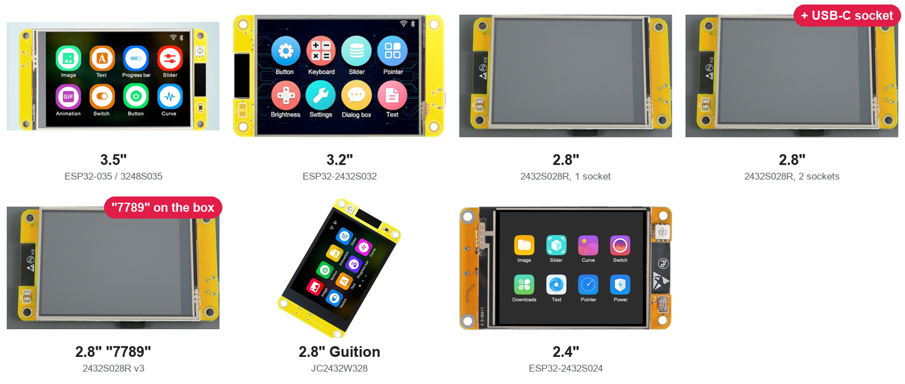

The website also lists the **3.2"** board (ESP32-2432S032), the 2.8" board whose box says
**"7789"**, and the 2.8" **Guition JC2432W328**. The model number is printed on the back of the
board. Not sure? Pick the closest one: if the screen stays black, install again with the next
choice; if the colours look wrong, use **Fix colours** (below).

### Step 1: Put the program on the board *(only the first time)*

1. Plug the board into the computer with the USB cable.
2. Open **[robo.learnnovice.com](https://robo.learnnovice.com/)** in Chrome or Edge.
3. Click **your** board in the list.

   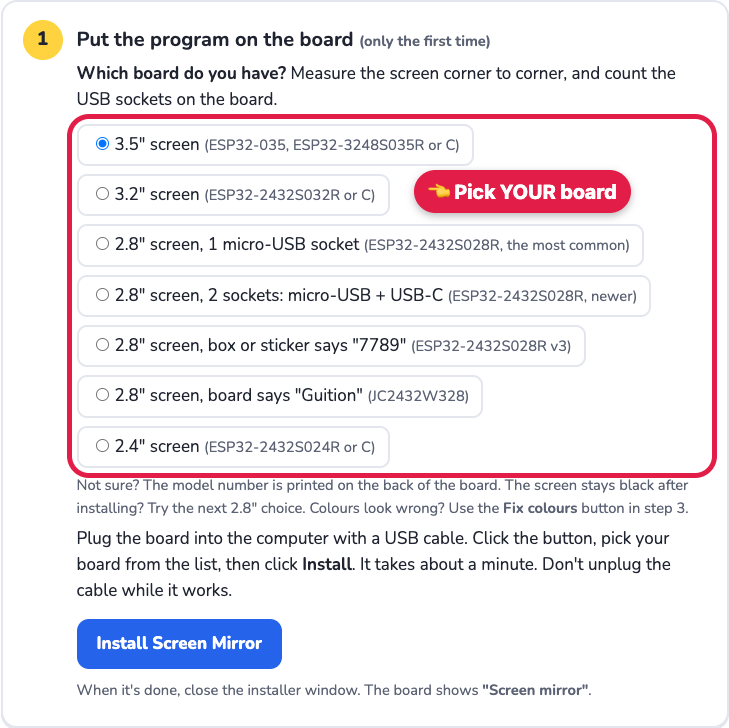

4. Click **Install Screen Mirror**.

   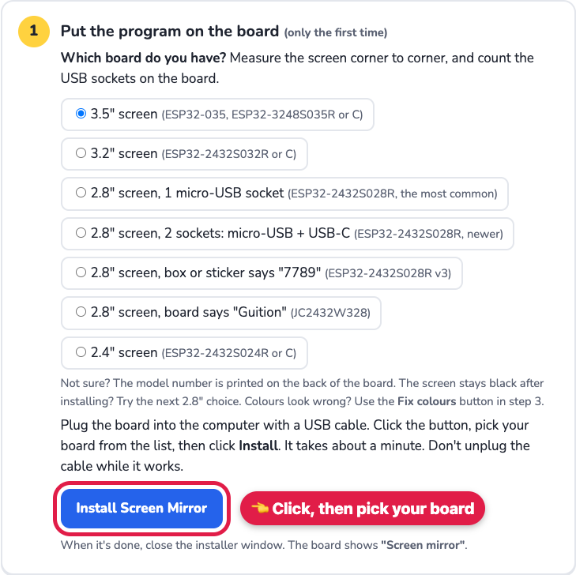

5. A small window opens. Click the line with **USB**, **CH340** or **serial** in it, then
   **Connect**.

   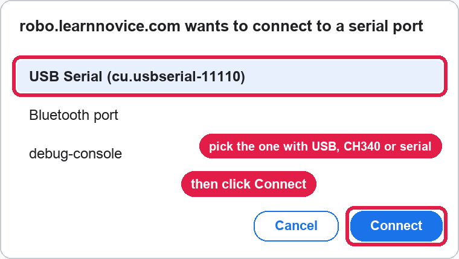

6. Click **Install**. If it asks about **erasing** the board, leave that box **empty**.
   Wait about a minute and **don't unplug** the board. When it says it's done, close the window.
7. The board's screen now says **Screen mirror** 🎉

   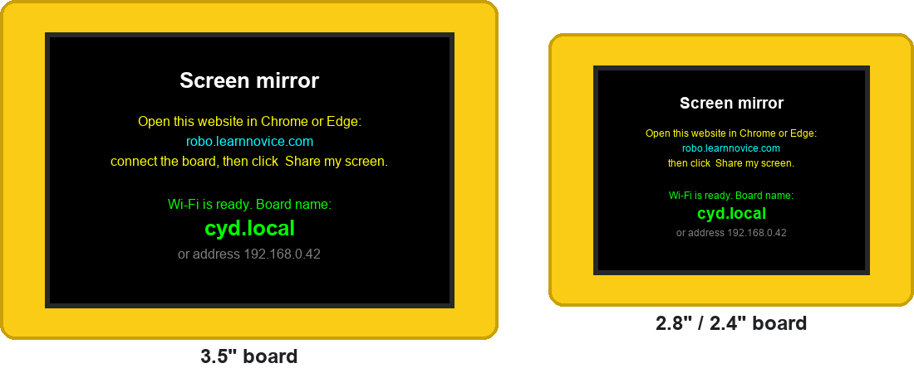

### Step 2: Connect

Click **Connect with cable**, then pick the **USB / CH340 / serial** line again and click
**Connect**. The page says **Connected with the cable** in green.

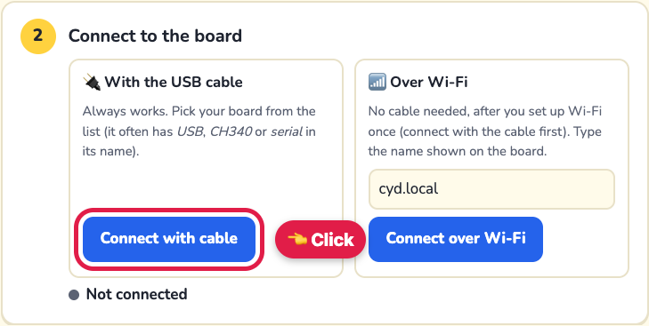

### Step 3: Share your screen

1. Click **Share my screen**.

   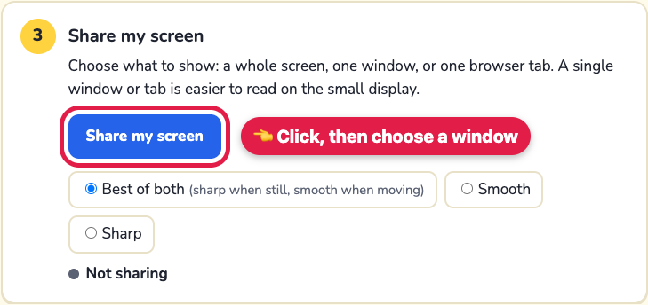

2. Chrome asks what to share. Pick **Window**, click the window you want (a drawing, a game,
   slides...), then click **Share**.

   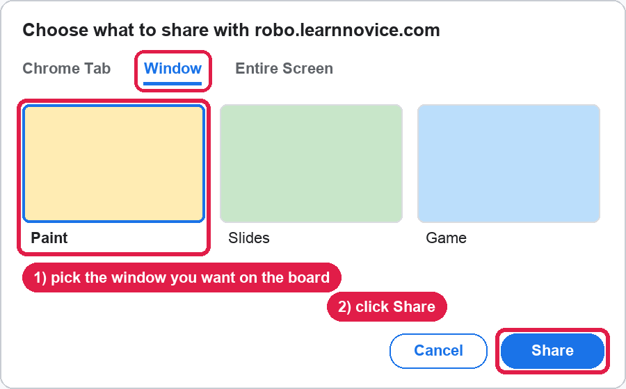

3. Look at the board: it shows the same picture! Click **Stop** when you're done.

> 🔤 The board's screen is small (480 × 320 dots on the 3.5", 320 × 240 on the 2.8" and 2.4"), so
> a whole computer screen gets squeezed and tiny writing is hard to read. Sharing **one window or
> one tab** makes it bigger and clearer.
>
> 🎮 For games and videos pick **Smooth**. For drawings and text pick **Best of both**.

### Colours look wrong?

Boards with the same name sometimes have different screens inside. If red looks blue, or the
picture looks like a photo negative, click **Fix colours** in step 3 (it appears once you're
connected). Each click tries the next fix; stop when it looks right. The board remembers it.

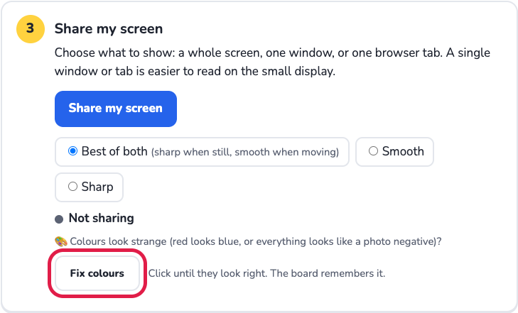

### No cable next time: use Wi-Fi

Set up Wi-Fi once. After that you can power the board from any phone charger and send your
screen through the air.

1. Connect **with the cable** (Step 2). A **Set up Wi-Fi** box appears.
2. Type your **Wi-Fi name** and **password**, and give your board a **name** (like `cyd`, or
   `cyd2` if your class has several boards). Click **Save Wi-Fi to the board**.
   The name and password go through the cable into the board only, not onto the internet.

   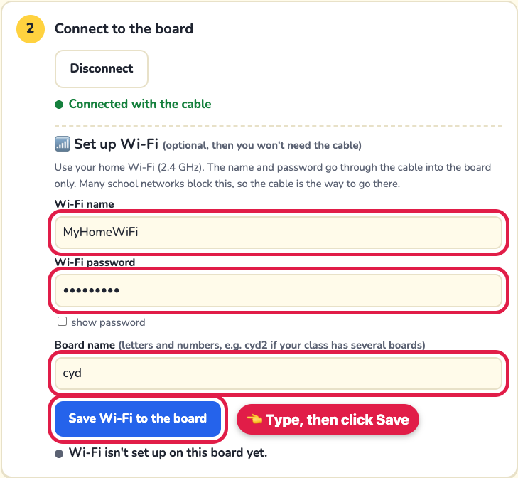

3. When it says **Wi-Fi is ready**, write down the board name (for example **cyd.local**).
   Click **Disconnect** and plug the board into a charger.

   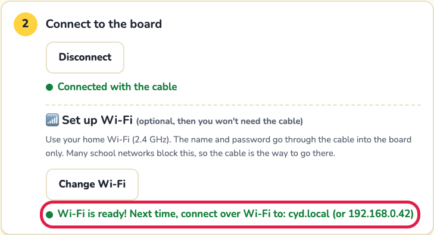

4. On the website, type the board name in **Over Wi-Fi** and click **Connect over Wi-Fi**. The
   first time, Chrome asks to *access devices on your local network*: click **Allow**.

   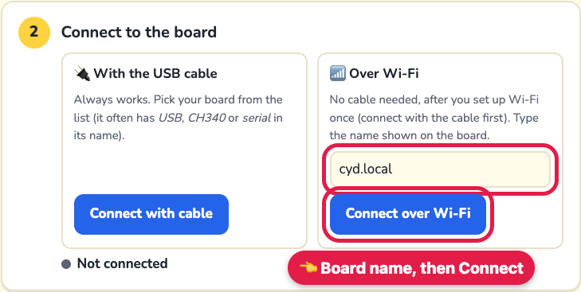

5. Click **Share my screen**, just like before.

> 📶 The board needs **2.4 GHz** Wi-Fi, and the computer must be on the **same** Wi-Fi. Keep the
> board **near the Wi-Fi router**: far away, the picture gets slow or stops. Many school networks
> don't let devices talk to each other: if it can't find the board, use the cable.
>
> The Wi-Fi you saved stays on the board, even when you install the program again (as long as
> you leave the erase box empty). Connecting the cable switches the board's Wi-Fi off for a
> moment; it comes back about 15 seconds after you click **Disconnect**.

### 🔬 How does it work? (the simple version)

- **It's a flip book.** A video is lots of still pictures shown quickly. The computer takes
  a picture of the screen up to 30 times every second and sends each one to the board.
- **It only sends what changed.** If you only move the mouse, the computer sends just the small
  patch around the mouse, not the whole screen. A still screen sends nothing at all!
- **Pictures are squeezed.** Each patch is saved as a **JPEG** (the same kind of file as phone
  photos), which makes it about 20 times smaller, so it travels fast.
- **The board has two brains.** The ESP32 chip has two **cores**: one catches the next picture
  while the other draws the current one, so neither has to wait.
- **Blurry when busy, sharp when calm.** When lots of things move (like a video), the computer
  sends smaller, blurrier pictures so it stays smooth. When things stop, it sends a sharp one.

This is what the board shows for the drawing on the computer screen in the picture above.
It's 480 × 320 dots, exactly as the board gets it:

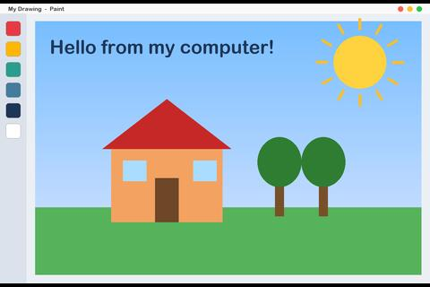

### 🧪 Things to try

- Share a **tab with a video**, then switch between **Smooth**, **Sharp** and **Best of both** on
  the page. What changes on the board? Which one is better for videos, and which one for reading?
- Watch the number that says **"… pictures a second"** on the page. Is it higher when only a small
  part of the screen moves, or when everything moves? Why do you think so?
- Draw something in a painting app and share only that window: the board becomes a mini canvas.
- Two boards? Give them different names (`cyd1`, `cyd2`) and connect each from a different computer.

### 📖 Words to know

| Word | What it means |
| :--- | :--- |
| **Pixel** | one tiny dot of colour on a screen. This board has 480 × 320 = 153,600 of them |
| **Frame** | one still picture. Videos are many frames shown quickly |
| **FPS** | *frames per second*: how many pictures arrive each second. 30 looks smooth |
| **Firmware** | the program that lives inside the board. Step 1 puts it there |
| **USB** | the cable that carries power and information between the computer and the board |
| **Wi-Fi** | sending information through the air with radio waves |
| **JPEG** | a way to make pictures much smaller by leaving out details your eyes barely notice |
| **Core** | a "brain" inside a computer chip. The ESP32 has two |

### 😕 Something not working?

| What you see | Try this |
| :--- | :--- |
| The board isn't in the list | another USB cable (it must carry data) or another USB port. On Windows, a grown-up may need to install the [CH340 driver](https://www.wch-ic.com/downloads/CH341SER_EXE.html) |
| "Board didn't answer" | do Step 1 (Install) first. Already did? Unplug the board, plug it back in, wait 3 seconds, connect again |
| "The page is using the board" when installing | click **Disconnect** in Step 2 first |
| Over Wi-Fi: "Can't reach the board" | is the board showing **Wi-Fi is ready**? Is the computer on the same Wi-Fi? Try the number shown under the name (like `192.168.0.42`) |
| Over Wi-Fi it's slow, or stops after a while | move the board **closer to the Wi-Fi router** (a few steps away, nothing metal in between): far away, pictures arrive too slowly. The charger or power bank may also be too weak for Wi-Fi: try another one (1 A or more). Still slow? Use the cable |
| The page doesn't work in Brave or another browser | use **Google Chrome** or **Microsoft Edge** |
| The picture freezes when you switch windows | keep the website's window open (it can be behind other windows, just not minimised) |

---

# 🔧 For teachers and the curious

The rest of this page explains how it's built: the firmware, the website, the protocol and the
measurements. You don't need it to use Screen Mirror.

Two ways to send a screen:

- **🌐 The website** ([https://robo.learnnovice.com/](https://robo.learnnovice.com/), files in [`docs/`](../../docs/)): install, then share over the
  USB cable or, after the one-time Wi-Fi setup, over Wi-Fi. Chrome or Edge, including Chromebooks.
- **📶 A Mac script**: `tools/mirror.sh` sends the Mac's screen over Wi-Fi (no browser).

## 🔧 How it works (technical)

The computer does the hard part: it captures the screen, shrinks it to 480x320 and compresses
only what changed. The board decodes and draws. Over USB the web page sends the frames through the
cable ([Web Serial](https://developer.mozilla.org/docs/Web/API/Web_Serial_API)); over Wi-Fi the
Mac script sends them through your network.

```
Mac: capture ─▶ fit into 480x320 ─▶ diff with last frame ─▶ JPEG of the changed rectangle ──Wi-Fi──▶ CYD: decode ─▶ panel
   (2 threads)      + mouse pointer      (nothing changed = nothing sent)   (full or half res)  ◀── ack ──  (core 0 receives, core 1 draws)
```

Full-screen video plays at **~28 fps**, close to the panel's limit (see below), and the picture is
full 480x320 whenever it isn't moving much.

## 🌐 The website

[`docs/index.html`](../../docs/index.html) and [`docs/mirror-worker.js`](../../docs/mirror-worker.js),
published on Cloudflare Pages (project `robo-learnnovice`) at https://robo.learnnovice.com/. It works in Chrome and Edge on Windows, macOS, Linux and
ChromeOS (they have Web Serial; Safari and Firefox don't).

To publish a change to `docs/` (needs a Cloudflare API token with Pages edit rights in
`CLOUDFLARE_API_TOKEN`, and the account id in `CLOUDFLARE_ACCOUNT_ID`):

```bash
npx wrangler@3 pages deploy docs --project-name robo-learnnovice --branch main
```

- **Install:** [ESP Web Tools](https://esphome.github.io/esp-web-tools/) flashes
  `docs/firmware/screen-mirror/screen-mirror.bin` (built from `[env:screen_mirror_web]`, which never
  reads a local `config.h`, so no Wi-Fi password can end up in it).
- **Capture:** the browser's own screen/window/tab picker (`getDisplayMedia`). The video track goes
  to a worker through `MediaStreamTrackProcessor`, so it keeps running at full speed while the
  page is behind other windows.
- **Send:** the worker applies the same rules as `mirror.py` (changed rectangle, auto half/full
  resolution, two frames in flight) and the page writes the frames to the cable at 2,000,000 baud.
- **Wi-Fi from the website:** the page saves the Wi-Fi name, password and a board name on the board
  over the cable (`'W'` message, kept in flash with `Preferences`). The board then runs a tiny HTTP
  server: `GET /hello`, `POST /frame` (body = the same 12-byte header + JPEG, answer `K`). Chrome 142+
  lets a secure page make these requests to `.local` names and private IP addresses once the visitor
  allows local network access ([Local Network Access](https://developer.chrome.com/blog/local-network-access));
  a page can't search the network, so it asks for the board's name. Measured: ~20-28 fps of
  full-screen half-resolution frames.
- While pictures come over the cable the board pauses Wi-Fi (`'U'` message): with the radio on, the
  2,000,000 baud line lost bytes. Wi-Fi comes back 15 s after the cable goes quiet.
- Memory is tight with Wi-Fi: frames are capped at 40 KB (the senders lower JPEG quality to fit).

Rebuild the installer firmware for **every board** after changing the code, then commit and push
(Cloudflare Pages publishes `docs/` from `main` automatically):

```bash
examples/screen-mirror/tools/build-web-firmware.sh   # 3.5", 2.8" (1 and 2 USB), 2.4"
```

Board differences (backlight pin, driver, panel size) live in `platformio.ini`; see
[BOARDS.md](../../BOARDS.md). The page and `mirror.py` read the panel size from the board's hello,
so they work on 480×320 and 320×240 panels alike. Problems we hit before and their fixes:
[LESSONS.md](../../LESSONS.md).

The guide pictures: `g01`–`g07` are screenshots of the real page (taken with Playwright, red
marks added in the page with CSS); `g00`, `g02b`, `g04b`, `g08` are drawn by
`tools/make_guide_pictures.py`.

## 📶 Wi-Fi from a Mac

```bash
# once: Wi-Fi for the board, then flash (this build also keeps working over USB)
cp examples/screen-mirror/include/config.example.h examples/screen-mirror/include/config.h
# edit config.h: WIFI_SSID / WIFI_PASSWORD (a 2.4 GHz network)
pio run -e screen_mirror -t upload

# on the Mac (the first run sets up examples/screen-mirror/.venv with mss + Pillow)
examples/screen-mirror/tools/mirror.sh
```

The board's waiting screen shows its Wi-Fi address, and the Mac finds it as
`cyd.local` (mDNS). If `.local` names don't resolve on your network, pass the IP shown on the
screen: `mirror.sh 192.168.0.177`. Ctrl-C stops mirroring; the board goes back to waiting.

**macOS permission:** the app you run it from (Terminal, iTerm, VS Code...) needs **System
Settings → Privacy & Security → Screen Recording**. Without it you get only the wallpaper.

## 🎛️ What to mirror

| Command | Shows |
| :--- | :--- |
| `mirror.sh` | the MacBook's built-in display |
| `mirror.sh --list` | lists displays; then `mirror.sh --display 2` for another one (e.g. an external monitor) |
| `mirror.sh --follow` | 480x320 points around the mouse pointer: a moving magnifier, **text stays readable** |
| `mirror.sh --follow 960` | 960x640 points around the pointer, shrunk to fit |
| `mirror.sh --pick` | point at two corners of an area (a window, a video), press Enter after each |
| `mirror.sh --region X,Y,W,H` | a fixed area in points (`--pick` prints this so you can reuse it) |

| Option | Default | Effect |
| :--- | :--- | :--- |
| *(auto)* | on | small changes at full 480x320; when over 35% of the screen moves (video, scrolling) the change goes at 240x160 shown 2x, then the area is re-sent sharp 0.25 s after it calms down |
| `--fast` | off | always 240x160 shown 2x: blurry, fastest |
| `--sharp` | off | always full 480x320: sharpest, ~15 fps when the whole screen moves |
| `--quality N` | 75 | JPEG quality 20-95 (lowered automatically if a frame won't fit the board's 48 KB buffer) |
| `--fps N` | 60 | capture at most N times a second |
| `--no-pointer` | off | don't draw the mouse pointer (macOS leaves it out of captures; the script draws one) |

A whole 1470-point-wide screen squeezed into 480 pixels makes text tiny; use `--follow` or
`--pick` for anything you need to read. The picture keeps its shape, with black bars if the
area isn't 3:2 (an ultrawide display gets wide bars).

## ⏱️ Measured on this board

With a video playing full screen, so ~90% of the screen changes every frame:

| Mode | fps | per frame | board: receive / draw |
| :--- | :---: | :---: | :---: |
| auto (default) / `--fast` | 28 | 6.4 KB | 15 ms / 30 ms |
| `--sharp` | 15 | 19 KB | 53 ms / 66 ms |

**Why not more:** sending a full 480x320 picture to the panel takes 30.7 ms at 80 MHz, the
ESP32's top SPI speed, so ~32 fps is the ceiling whenever the whole screen changes; half-res
frames already draw in 30 ms. At full resolution, decoding (66 ms) and Wi-Fi into the ESP32
(~300 KB/s with the Arduino core's small TCP window) limit it to ~15 fps, which is why auto mode
drops to half resolution while a lot moves. Smaller changes are faster: typing, the pointer or a
video in a window send only the rectangle that changed, and a still screen sends nothing (just a
12-byte ping every 2 s). Delay from Mac to panel is about three frames (~100 ms).

## ✨ How it works

1. **Capture threads (Mac):** two threads take turns: `mss` grabs the area (~25 ms each), Pillow
   fits it into 480x320 and draws the pointer, whose position comes from CoreGraphics (macOS
   leaves it out of captures). The newest frame is always ready (~54 a second).
2. **Diff:** the sender compares that frame with the last one it sent and snaps the changed
   bounding box to 16-pixel JPEG blocks. Nothing changed → nothing sent.
3. **Pick resolution (auto):** a box over 35% of the panel goes at half resolution and is
   remembered as blurry; once nothing big has moved for 0.25 s, the blurry area is re-sent sharp.
4. **Send:** a 12-byte header (`'J'`, zoom, x, y, length) plus a baseline JPEG of just that box.
   Up to two frames may be un-acked, so the next one is already on its way while the board
   takes the last.
5. **Receive (CYD core 0):** a FreeRTOS task next to the Wi-Fi stack reads the frame into one of
   two 48 KB buffers and acks at once, so the Mac sends the next frame while this one is drawn.
6. **Draw (CYD core 1):** JPEGDEC decodes a few 16x16 blocks at a time, zooms them if needed and
   pushes them by DMA while it decodes the next blocks (same pipeline as `video-clip`).

Protocol (TCP port 8767, or the USB serial line at 2,000,000 baud; little endian). Over USB the
sender repeats `"CYMH"` until the hello arrives (the board skips any late copy, since every frame
starts with `'J'` or `'Q'`), and the board prints no log lines while a USB sender is active. For
headroom at 2,000,000 baud the UART interrupt runs on core 0 and empties the chip's 128-byte
buffer every 32 bytes (the core's default is 112). Measured: 80 s of full-screen frames over USB,
12-14.5 fps, no lost bytes. On connect the board sends
`"CYM1", u16 width, u16 height, u32 max JPEG bytes, u8 max zoom`. Then the Mac repeats
`u8 'J', u8 zoom, u16 x, u16 y, u16 0, u32 len, len bytes of JPEG`; the board answers each with
a one-byte `'K'` once it has it, and the Mac keeps at most two frames un-acked.
`len = 0` is a keep-alive and tag `'Q'` means the sender stopped; the board drops a Mac it hasn't heard from for 10 s, and a new
connection always replaces the old one, so restarting the script just works.

## Files

| File | Runs on | Purpose |
| :--- | :--- | :--- |
| `src/main.cpp` | CYD | USB + Wi-Fi/mDNS receive task, JPEG drawing |
| `include/config.example.h` | CYD | copy to `config.h` (git-ignored) for Wi-Fi; without it the board uses USB only |
| `../../docs/index.html`, `../../docs/mirror-worker.js` | browser | the website: install, connect, capture, send over USB |
| `tools/mirror.sh` | Mac | creates `.venv` (git-ignored) on first run, then runs `mirror.py` |
| `tools/mirror.py` | Mac | capture, diff, pick resolution, encode, send |

## Serial output

```
[WiFi] joined "my_network" as 192.168.0.177
[Mirror] listening on cyd.local:8767
[Mirror] Mac connected from 192.168.0.137
[ESP32-035] 28.4 fps, 6.4 KB/frame, receive 15.0 ms, draw 30.0 ms (89% of panel per frame)
```

No sound: the board's 8-bit speaker isn't worth streaming system audio to.

🤖 Working with an AI assistant? Give it [AI_PROMPT.md](../../AI_PROMPT.md).
