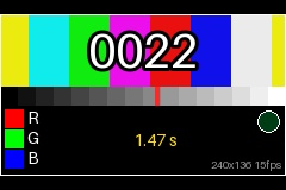

# 🎬 Video Clip Player for ESP32-035 (CYD 3.5")

[](https://platformio.org/)
[]()
[]()

Plays a short video clip with sound on the **ESP32-035 (CYD 3.5" / ST7796 480x320)**, looping
forever. A script on your computer turns any video into a `clip.bin` (JPEG frames + 8-bit audio),
and a second script writes it into its own area of the board's 4 MB flash. No SD card needed.



<sub>Screenshot: the synthetic test pattern from `make_clip.py --test-pattern`.</sub>

> **Only convert videos you have the rights to use** (your own footage, public-domain or suitably
> licensed clips). Keep source videos and `clip.bin` files out of this repository.

---

## 🎮 Controls

| Touch | What it does |
| :--- | :--- |
| **1 tap** | Pause / resume (sound goes quiet while paused) |
| **2 taps** | Mute / unmute |

`PAUSED` and `MUTED` show in the black bar under the picture. A single tap is acted on once the
300 ms double-tap window has passed.

## ✨ How it works

- **Picture**: each frame is a 240×136 baseline JPEG, shown **2× (480×272)** in the middle of the
  screen with black bars above and below. The firmware reads a frame from flash into RAM, decodes
  it with [JPEGDEC](https://github.com/bitbank2/JPEGDEC) a few 16×16 blocks at a time, doubles the
  pixels and sends them over 80 MHz SPI **by DMA while the next blocks decode**. A frame takes about
  30 ms, so 15 fps leaves plenty of room.
- **Timing**: the frame shown is picked from the time since playback started, so the clip runs at
  its real speed. If a frame is ever late, the player skips ahead instead of slowing down.
- **Sound**: unsigned 8-bit mono PCM at 8 kHz goes through I2S into the ESP32's **built-in DAC on
  GPIO 26** (the speaker amplifier). It is fed by its own task on core 0 so decoding never starves
  it, and it follows the same clock as the picture. The DAC runs at 32 kHz with interpolation:
  asking the ESP32 for 8 kHz in DAC mode really runs at ~44 kHz.
- **Looping**: at the end the clip starts again from the first frame, picture and sound together.

## 🛠️ Build, make a clip, flash it

### 1. Flash the firmware (once)

```bash
pio run -e video_clip -t upload
pio device monitor -e video_clip     # shows fps
```

This also writes the partition table below. With no clip in flash yet, the screen says
**"No video clip in flash"** and tells you to run `tools/flash_clip.sh`.

### 2. Make a clip on your computer

`tools/make_clip.py` needs Python 3 with PyAV, numpy and Pillow (`pip install av numpy pillow`,
ideally in a venv). Run it from `examples/video-clip/`:

```bash
python3 tools/make_clip.py my_video.mp4 --start 12 --dur 30 -o clip.bin --preview preview.png
python3 tools/make_clip.py --test-pattern --dur 10 -o test.bin      # synthetic clip, no video needed
```

| Option | Default | Meaning |
| :--- | :---: | :--- |
| `--start SEC` / `--dur SEC` | whole video | Part of the video to use |
| `--audio FILE` | the video's own sound | Take the sound from a separate file |
| `--no-audio` | | Picture only |
| `--fps N` | 15 | Frame rate |
| `--width W --height H` | 240 × 136 | Decoded frame size (shown 2×, max 240 × 160) |
| `--rate HZ` | 8000 | Audio sample rate |
| `--quality auto\|1-95` | auto | JPEG quality; `auto` picks the best one that still fits the flash |
| `--budget BYTES` | 0x2F0000 | Space available (the clip partition) |
| `--preview PNG` | | Contact sheet of frames decoded back from the file |

`tools/check_clip.py clip.bin` checks a finished file (header, index, every JPEG, audio, size).

How long a clip fits? The partition holds 3,080,192 bytes. At 15 fps with 8 kHz sound, a 51 s
clip of real footage fits at quality ~55 (about 3.4 KB per frame); shorter clips get higher
quality automatically.

### 3. Flash the clip

```bash
tools/flash_clip.sh clip.bin                        # default port /dev/cu.usbserial-11120
tools/flash_clip.sh clip.bin /dev/cu.usbserial-XXXX
```

It checks the size and the `CLIP` header, then writes the file at `0x110000` with the repo's
esptool (`.venv/bin/python -m esptool`). The board resets and starts playing. The firmware isn't
touched, so you can swap clips without rebuilding, and reflash the firmware without re-sending
the clip.

## 💾 Flash layout (`partitions.csv`)

| Name | Type | SubType | Offset | Size |
| :--- | :--- | :--- | :--- | :--- |
| nvs | data | nvs | `0x9000` | `0x5000` |
| otadata | data | ota | `0xE000` | `0x2000` |
| app0 | app | ota_0 | `0x10000` | `0x100000` (1 MB) |
| clip | data | `0x40` | `0x110000` | `0x2F0000` (2.94 MB) |

## 📦 `clip.bin` format

Little endian. A 64-byte header, then the frame index, the JPEGs and the audio. Offsets are from
the start of the file (= start of the partition).

| Offset | Type | Field |
| :---: | :--- | :--- |
| 0 | `char[4]` | magic `CLIP` |
| 4 | `u16` | version = 1 |
| 6 | `u16` | width (240) |
| 8 | `u16` | height (136) |
| 10 | `u16` | fps × 100 (1500 = 15 fps) |
| 12 | `u32` | frame count N |
| 16 | `u32` | index offset: N+1 `u32` offsets, frame i = bytes `[idx[i], idx[i+1])` |
| 20 | `u32` | audio rate in Hz (8000), 0 = no audio |
| 24 | `u32` | audio offset |
| 28 | `u32` | audio bytes |
| 32 | `u8[32]` | zero padding |

Frames are baseline JPEG (not progressive), YCbCr 4:2:0, each starting 4-byte aligned. Audio is
unsigned 8-bit mono (128 = silence), the same length as the video.

## 🩺 Serial output

```
[Clip] 240x136 @ 15.00 fps, 768 frames (51.2 s), biggest frame 6688 bytes
[Clip] audio 8000 Hz u8 (409600 bytes), DAC at 32000 Hz
[ESP32-035] Heap free: 267692 bytes (largest block 110580)
[ESP32-035] 15.0 fps (0 skipped, 30.0 ms/frame), audio 7987 Hz
```

- `esp_core_dump_flash: No core dump partition found!` at boot is harmless: this layout gives
  the clip the space a core dump partition would use.
- If the picture has noise or glitches, your panel may not handle 80 MHz SPI. In `platformio.ini`
  under `[env:video_clip]`, change `-D SPI_FREQUENCY=80000000` to `55000000`.

## 📁 Layout

```
video-clip/
├── src/main.cpp          # player: flash reads, JPEG decode + 2x DMA push, DAC audio task, taps
├── partitions.csv        # 1 MB app + 2.94 MB clip partition
├── tools/make_clip.py    # video -> clip.bin (or --test-pattern)
├── tools/check_clip.py   # validate a clip.bin, render a frame like the board does
├── tools/flash_clip.sh   # write clip.bin to 0x110000
└── docs/screenshot.png
```
